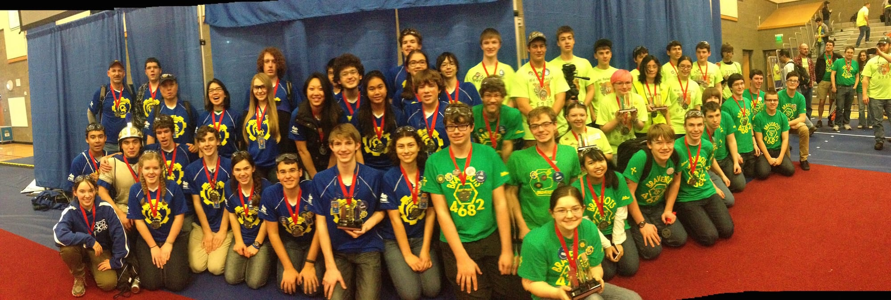
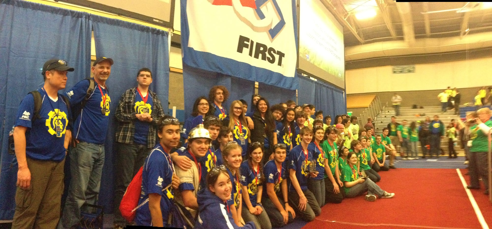

Tonight Spartonics Team 4915 finished second at Shorewood!  We were selected for Quarter Finals matches by the 4th-seed Wild Robocats Team 3787 -- which picked us for their Alliance at Glacier Peak -- as their first pick, and at Shorewood District event we were joined by Team 4682 Brave Bots (all pictured here).

Together we went all the way to the Final match, finishing first in the top 4 Alliances for the Semi-Finals and the top 2 Alliances for the Finals.

Best of all we had a blast and are currently ranked 17th overall in WA and OR. While we are not competing next weekend, other teams are, so we won't know for certain if we made the top 64 teams in the state, but the chances of going to Eastern Washington University at Cheney is very likely.

Keep checking back here or follow us on Instagram or Twitter for instant news and updates!

