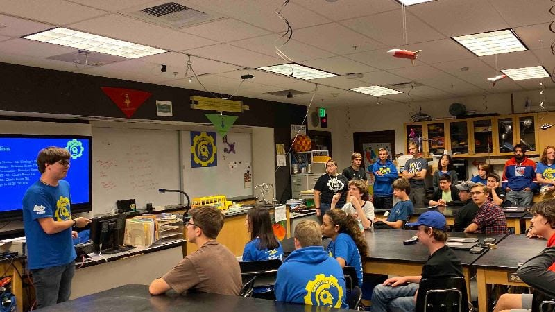
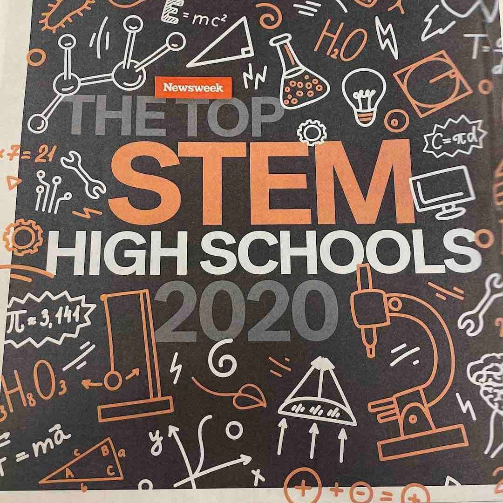
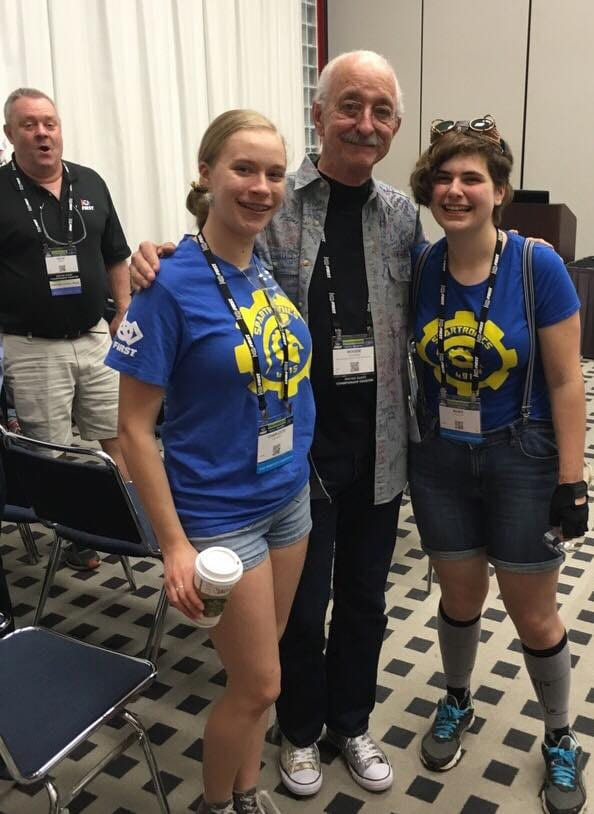
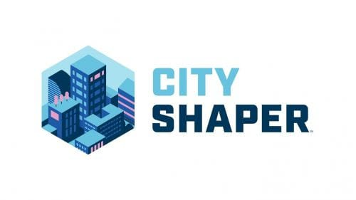

**A News Season Begins!**

Welcome to the first newsletter of Spartronics' 2019-2020 season!

Both old and new team members are already working hard at our bi-weekly meetings to ensure that we’re prepared to jump into creating our robot after Kickoff. For those who don’t know, Kickoff is a world-wide event scheduled for January 4th. It marks the start of our robot build season as the new game for our 2020 competitions is fully revealed.

On January 4th we also pick up our "kit of parts," which traditionally includes key components for our robot as well as sample game pieces.

In the past, we only had six weeks after Kickoff to construct our robot before setting down our tools and  sealing our new robot in a bag before the first competitions. This year the rules have changed; we’re now free to continue working on our robot throughout the competition season!

Everybody on the Spartronics team is excited about the coming season and how we’ll be able to take advantage of this extra time.

Read these newsletters to stay up-to-date on our progress, or like us on Facebook [here](https://spatronics4915.us9.list-manage.com/track/click?u=83401ef6f6634dd529783840a&id=623735195e&e=96dbbba0fa) or Instagram [here](https://spatronics4915.us9.list-manage.com/track/click?u=83401ef6f6634dd529783840a&id=95a136057d&e=96dbbba0fa)!

**"Takin' 'bout Girls Generation"**

Girls Generation, an annual competition that showcases the talented young women in FIRST Robotics, took place recently on Oct. 12th - 13th. Spartronics sent 10 girls and a group of supportive mentors to the event.

While we may not have won, we did make it to the semifinals and everybody who participated gained something from the experience. Attendees were able to get hands-on experience with a robot and network with other teams.

Sunny, our robot’s driver during the competition, sums it up best with a simple quote: “I think I learned a lot, and I had a lot of phun.”

**Thank You Woodie Flowers**

Unfortunately, not all the news we have to share is positive. [Woodie Flowers](https://spatronics4915.us9.list-manage.com/track/click?u=83401ef6f6634dd529783840a&id=3dd086158d&e=96dbbba0fa), a Co-Founder of FIRST Robotics, Professor Emeritus of Mechanical Engineering at MIT, Co-Chair of the FIRST Executive Board, and Distinguished Advisor to FIRST, recently passed away.

Woodie was a pillar of support for FIRST since the organization's inception. He coined the term "Gracious Professionalism," summarizing FIRST’s belief that “fierce competition and mutual gain are not separate notions” and that teams must always treat each other with respect.

Many Spartronics students and mentors over the years had the special opportunity to meet the brilliantly talented Woodie Flowers, who was always kind, accessible and giving.

While Woodie may no longer be with us, part of his legacy will always live in the organization he cared for so deeply and all those who he influenced for the better.

Mark your calendars: Spartronics is hosting a FIRST LEGO League ([FLL](https://spatronics4915.us9.list-manage.com/track/click?u=83401ef6f6634dd529783840a&id=7c9fa794cd&e=96dbbba0fa)) competition on Saturday, December 7th from 10 am - 4 pm. In FLL, teams of kids ages 9-14 build and programmable LEGO robots. This year, participants will be playing in a game called "City Shaper."

See the game video here: [https://youtu.be/y\_mTQZQ8Kzc](https://spatronics4915.us9.list-manage.com/track/click?u=83401ef6f6634dd529783840a&id=14c7799796&e=96dbbba0fa)

Everyone is welcome to come and watch this exciting event!
