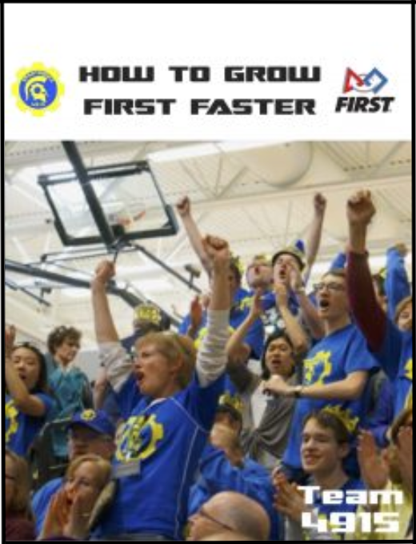

Team 4915 Chairman's entry for 2018 was inspired by FIRST co-founder Dean Kamen. "We need to grow FIRST faster!" he said on the Kickoff video for this year's game, "Power Up."  This has been the mantra of Spartronics since our inception: to grow STEAM and STEM and FIRST Robotics on Bainbridge and beyond since we started in 2013.

One of our greatest strengths has always been our Marketing and Fundraising skills. Our business acumen has allowed us to raise nearly $100,000 in the last three years. Most importantly, our alumni, because of our local business support, mentor support, family support and community support, are now beginning to graduate from some of the finest colleges and universities around!

We hope this toolkit can help start new teams, help existing ones and be expanded as other teams contribute new ideas.

Spartronics believes that together we grow FIRST faster

[Download it here](/files/How-to-Grow-FIRST-Faster-1.pdf) (7 mb)

[Download higher-quality version here](https://drive.google.com/open?id=1S5lAMwHyoQFhTIAjuYve1niKlQ4T8Nyp) (22 mb)
