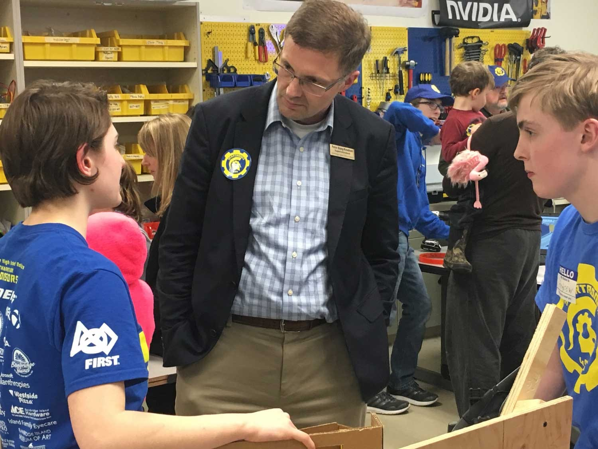

Please join us on Wednesday March 13 for our All-Robotics Open House showcasing Robotics and STEAM on Bainbridge Island. We want teachers, students of all ages, family, parents, and community members to come see our Robots in action!

Our six**‐**week robot build season for Spartronics Team 4915 -- which is composed of 48 students, 17 professional mentors, and Coach Chee -- ended on Feb. 19 when we bagged CHAOS, our new robot. The Open House will give you chance to see CHAOS in action!

We'll share what we've been doing while having the “hardest fun we’ll ever have.” You’ll meet our programming, mechanical, electrical/pneumatic, and marketing sub-teams at this student-led event. You'll also have the opportunity to meet a FIRST Lego League team and FLL Junior team members.

We hope to see you there!

p.s. Never been to one of our annual Open Houses? Take a couple of minutes and watch this Spartronics YouTube video of our 2015 Open House recap:

<iframe src="https://www.youtube.com/embed/xk_0d-PKopI" width="560" height="315" frameborder="0" allowfullscreen="allowfullscreen"></iframe>
