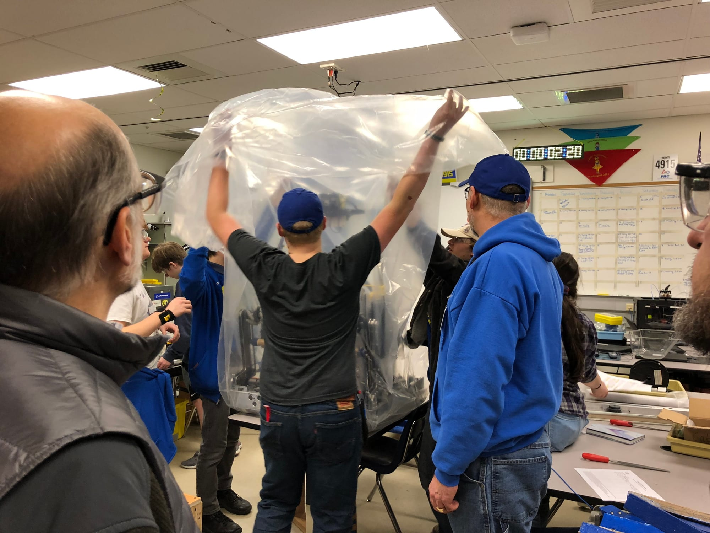
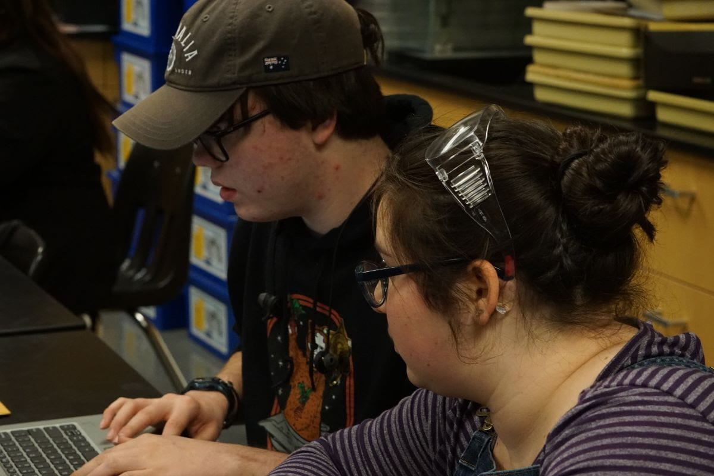
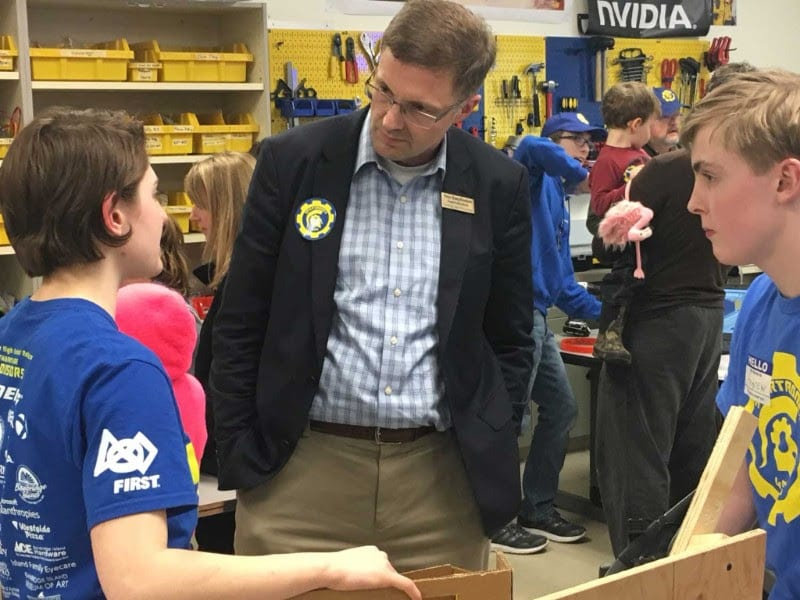
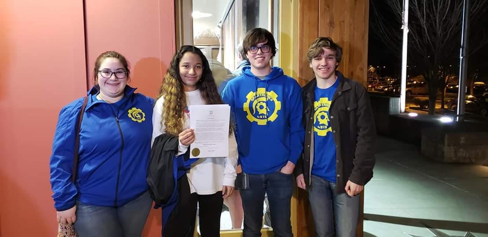
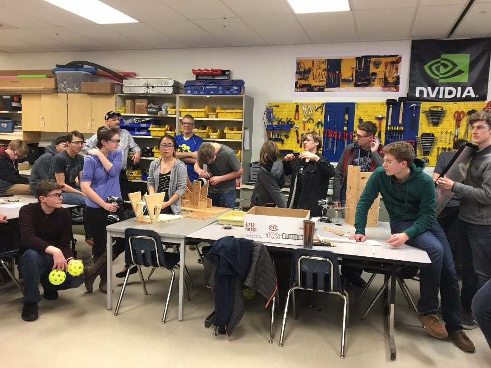
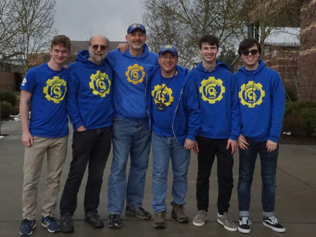

 **Bag Day & Start of** **Competition** **Season** Build Season is over! After a great deal of testing and hard work, including a complete redesign the robot’s hatch intake system, CHAOS was finally bagged on February 19! But while Build Season may be over, that doesn’t mean that the team will stop meeting. Competition season has begun! Our first competition will be at [Auburn Mountainview High School](https://spatronics4915.us9.list-manage.com/track/click?u=83401ef6f6634dd529783840a&id=e1a4196487&e=96dbbba0fa), on March 8th to 10th. It will be followed by our next District competition at [Glacier Peak High School](https://spatronics4915.us9.list-manage.com/track/click?u=83401ef6f6634dd529783840a&id=5cac6fbb6d&e=96dbbba0fa) on March 22nd to March 24th. Afterward, we’ll likely qualify for the Pacific Northwest District Championship at the [Greater Tacoma Convention Center](https://spatronics4915.us9.list-manage.com/track/click?u=83401ef6f6634dd529783840a&id=3568e50b0e&e=96dbbba0fa) from April 3rd to April 6th. If we do well enough there, we’ll qualify for Worlds at Houston's [George R. Brown Convention Center](https://spatronics4915.us9.list-manage.com/track/click?u=83401ef6f6634dd529783840a&id=a373b54511&e=96dbbba0fa) on April 17th to April 20th. In our opinion, every one of these competitions is more exciting to watch in person than a March Madness college basketball game. They're free to watch and open to all ages, attendees are welcome! But if you can’t make it in person, we will provide ongoing updates on our Facebook and Twitter live during the competition and a link to a live feed from Twitch will appear on the homepage of our website. Everyone on the team is excited to see how CHAOS will perform!  **Subteam Updates** With our first event approaching rapidly, the team is doing everything it can to prepare. The **Mechanics** and **Electronics** subteams continue to labor over our second robot, which when complete will allow for more drive-team practice and programming time. Electronics is also working on using LED’s to spruce up our driver station (which controls the robot). **Programming** students are helping with driver station, enabling its LED’s to flash Spartronics colors and change based on what the robot is doing. They’re also further developing dynamic path planning and CHAOS’s autonomous program for this year’s Sandstorm Phase. While **Marketing** may not be working directly on the robot, that doesn't mean they’re not busy. The subteam is continuing to prepare for our BIGGEST EVENT OF THE YEAR: our **All-Robotics Open House**next Wednesday, March 13, 5:00 - 7:00 PM. See all the details in the story below!  Sup. of Schools Peter Bang-Knudsen at a previous Open House **Spartronics Open House** Do you want to see one of our robots? Come to our Open House! You'll will have the chance to both see CHAOS in action and talk to the students who build it! Students from every subteam will be present, giving you a chance to see everything the team is doing. Spartronics won't be the only team present; an FLL team and two FLL Junior teams will also be there. These young students are just as passionate about robotics as FIRST as robotics would be thrilled to speak with you! We'll see you there!  **Bainbridge Island Girl Up** Spartronics team member Merrill Keating has founded a Girl Up club for middle and high school girls! Founded by the United Nations in 2010, [Girl Up](https://spatronics4915.us9.list-manage.com/track/click?u=83401ef6f6634dd529783840a&id=ab4281cabb&e=96dbbba0fa) is a global organization that aims to empower young women and promote gender equality. Merrill’s Bainbridge Island Girl Up (BIGU) club will join a community of over 1900 other clubs in the US alone, each of which is fostering social change and empowering young women. On February 26 Mayor Kol Medina issued a [proclamation](https://spatronics4915.us9.list-manage.com/track/click?u=83401ef6f6634dd529783840a&id=132cef3e21&e=96dbbba0fa) at City Hall declaring the Month of March 2019 as "Bainbridge Island Girl Up Month,” coinciding with International Women's Day on March 8th. Gender equality and getting more girls involved in STEM is a mission that Spartronics can get behind; several team members (Pictured Above)  journeyed to City Hall to support Merrill and Bainbridge Island Girl Up. Bainbridge Island Girl’s Up Month also coincides with our All-Robotics Open House, where attendees will have a chance to meet some of the girls on Spartronics who are already helping to diversify STEM. We wish Merrill and the rest of BIGU the best of luck in forging the next generation of female leaders!   **Sponsor Spotlight: Boeing**

Ever since its establishment in 1916, Boeing has been a central pillar of the Pacific Northwest. They are the region's largest employer, with over 80,00 employees, and are committed to youth achieving their potential through educational enrichment and support programs that promote academic success, independence, and economic sustainability. One of the ways they help youth achieve their potential is through their support of [FIRST](https://spatronics4915.us9.list-manage.com/track/click?u=83401ef6f6634dd529783840a&id=ef45785272&e=96dbbba0fa), both in general and with Spartronics in particular. Boeing is the presenting sponsor of the 2019 FIRST competition season and provided $1.5 million grant to FIRST in February 2018. They’ve also been a key component to Spartronics success every year of the team's existence.

Boeing has impacted Spartronics both monetarily and through the countless hours and enormous contributions of our three Boeing mentors: Jon Sachs, Jim Carr and Randy Groves (pictured above with several Spartronics Marketing subteam members).  These mentors are integral to the team's success. Without John Sachs, one of our founding mentors, the team may not even exist. We asked them a few questions about Boeing's support of Spartronics: **Spartronics:** Can you give us a brief description of your company and what it does? **Boeing**: Boeing is the world's largest aerospace company, employing more than 140,000 people across the United States and 65 other countries, representing one of the most diverse, talented and innovative workforces anywhere! We design and build some of the world’s most advanced commercial and military aircraft, satellites & spacecraft, electronics & defense systems, rocket launch systems, advanced information & communication systems, and much more. Boeing and its heritage companies, such as McDonnell Douglas and Hughes, have a long tradition of aerospace leadership and innovation (first commercial jet, first spacecraft to carry US astronauts to space), and that entrepreneurial mindset continues today both internally and with our investments in and partnerships with dozens of amazing startups including Aurora Flight Sciences, Kittyhawk, Morf3D, and others. See ore at [boeing.com](https://spatronics4915.us9.list-manage.com/track/click?u=83401ef6f6634dd529783840a&id=27c9254af9&e=96dbbba0fa). **Spartronics:** Why is Boeing sponsoring Spartronics?

**Boeing:** ecause it’s the hardest fun you will ever have! Boeing has a long history of sponsoring the FIRST organization, including providing grants to teams with Boeing mentors and funding university scholarships.  To quote Dennis Muilenberg – Boeing Chairman, President and CEO,and proud parent of a FIRST participant; “Boeing is committed to supporting STEM programs like FIRST through employee volunteerism and charitable grants. By exposing students to STEM subjects and experiences and teaching them how to apply what they’ve learned in real and relevant ways, we hope to inspire future generations of dreamers and doers.” John, Jim, and Randy, Boeing employees who live on the island and serve as mentors on Spartronics, are very excited for Boeing to be the game sponsor of the 2019 FIRST Robotics Competition, Destination: Deep Space!

**Spartronics:** Is there a way Spartronics fans can support Boeing?

**Boeing:** We encourage all team members and visitors of the Spartronics website to follow Boeing on any of the Social Media sites below; you may find your future career here! [Instagram](https://spatronics4915.us9.list-manage.com/track/click?u=83401ef6f6634dd529783840a&id=48b233a131&e=96dbbba0fa), [Facebook](https://spatronics4915.us9.list-manage.com/track/click?u=83401ef6f6634dd529783840a&id=38ae1175f0&e=96dbbba0fa), [Twitter](https://spatronics4915.us9.list-manage.com/track/click?u=83401ef6f6634dd529783840a&id=5218022a01&e=96dbbba0fa), [YouTube](https://spatronics4915.us9.list-manage.com/track/click?u=83401ef6f6634dd529783840a&id=b581960a8a&e=96dbbba0fa)

**Spartronics:** Is there anything else you would like us to include in Boeing's Sponsor Spotlight newsletter feature? **Boeing:** We’d like to thank all of the great Spartronics mentors who have been volunteering countless hours with the team, sharing their experience and inspiring our next generation of STEM leaders. We’d also like to thank Spartronics for “paying it forward” by participating each year in our annual Boeing Earth Day event at Islandwood on Bainbridge; just another example of teaming together to achieve great things!

Thank you Boeing and thank you John, Jim and Randy!
