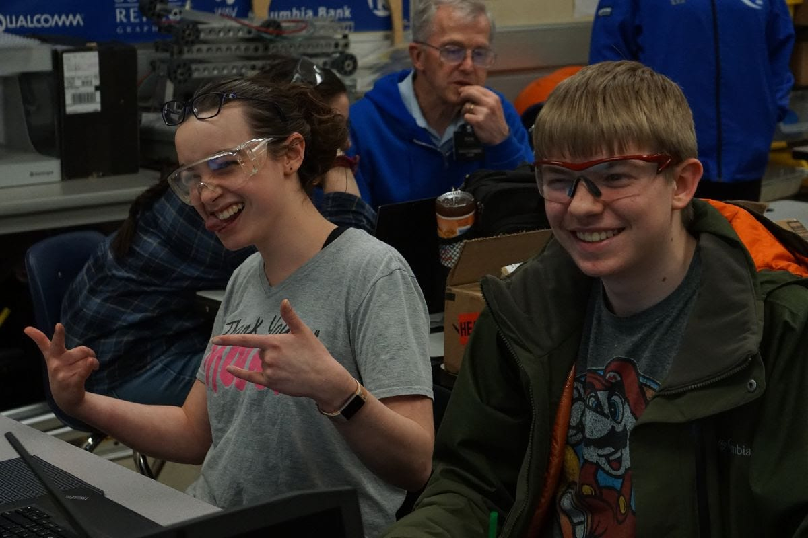
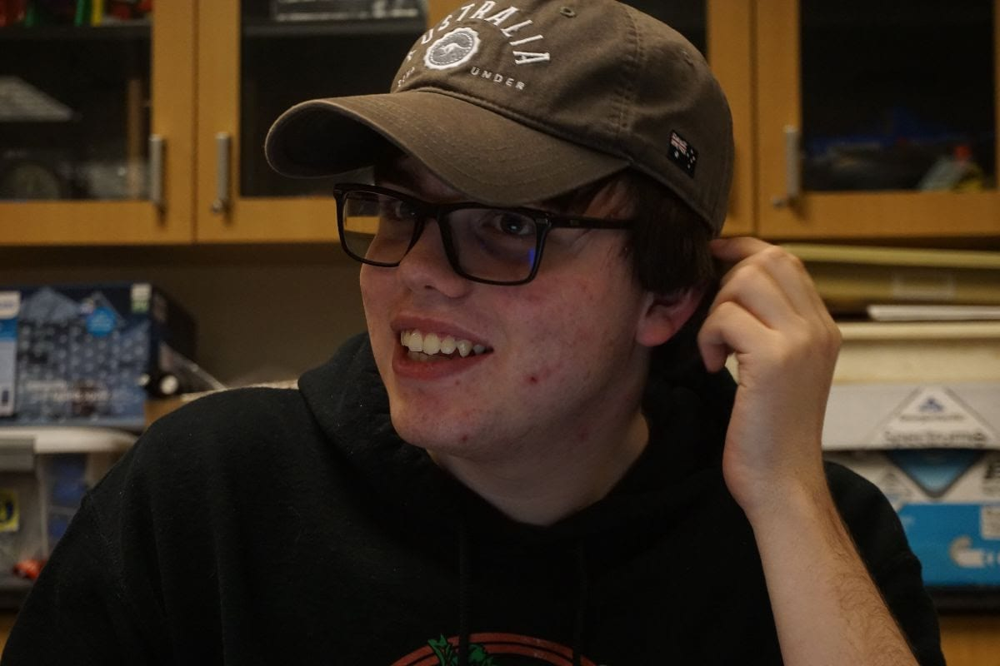
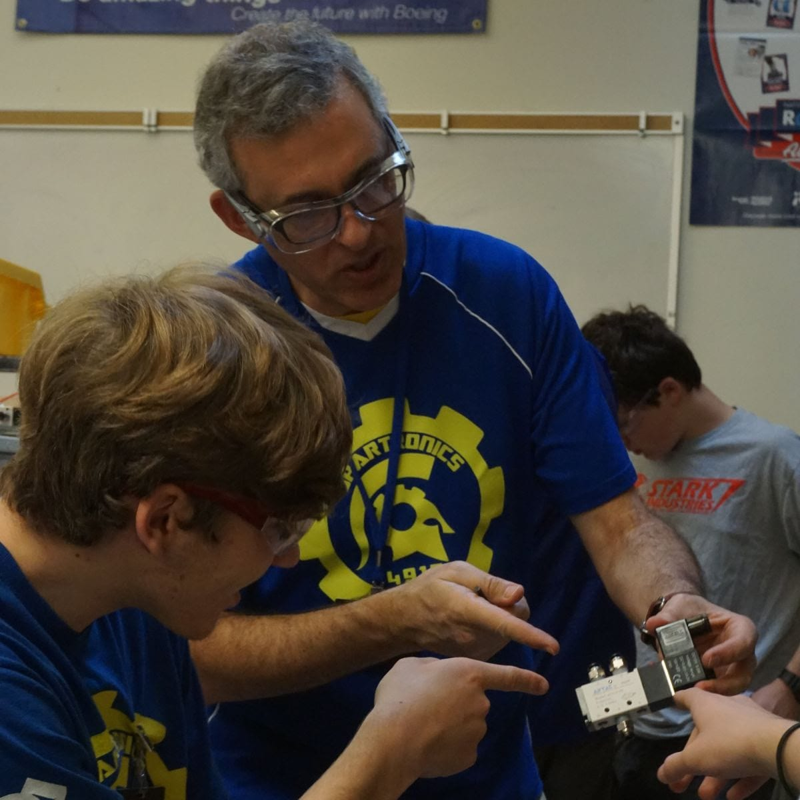
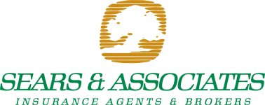

 **Subteam Updates:** Build Season marches on! Students are continuing their hard work, aiming to make the best robot they can. The **Mechanics** subteam has moved on from design to manufacturing the various parts used in the robot’s subsystems. Once these parts have been manufactured, students will be able to begin assembling them into a functioning robot. Members of the **Electronics** subteam have finished all electronics systems, including the final electronics board. This electronics board will be a part of the final robot and will contain its electronic systems. They’ve also completed a similar pneumatics board. For those who don’t know, pneumatic systems are those which utilize pressurized air. **Programming** has also been very productive! They’ve finished writing code for all the robot’s major subsystems and will soon move on to testing this code on the testbed, which contains the circuits that will eventually be present on the actual robot. Finally, **Marketing** has also been busy with its Build Season tasks. Most importantly, the subteam has begun preparations for upcoming All Robotics Open House. The event’s on Wednesday night, March 13, 5-7 PM and everybody is invited! Visitors will be able to meet Spartronics new robot and, hopefully, younger students from one of the Islands’ FLL teams. We’re excited to see you there! 

Chris Mentzer, Co-Captain and Marketing Leader Becomes Spartronic's First Driver from the Marketing subteam!

**Drive Team:**

Drive Team has been announced! Below is a list of everyone and their roles:

*   **Kenneth Wiersema -** Drive Coach

*   **Chris Mentzer  -** Driver

*   **Cruz Strom  -** Mechanism Controller

*   **Ronan Bennett -** Human Player

*   **Jack Chapman -** Primary Technician

*   **Violet Advani -** Backup Drive Coach

*   **Ethan Rininger -** Backup Driver

*   **Peter Hall -** Backup Mechanism Controller

*   **Declan Freeman-Gleason -** Backup Human Player

*   **Lucas Nalley -** Backup Technician

Congratulations!

**Woodie Flowers Award**

Riyadth Al-Kazily (Pictured Above) has been chosen by Spartronics students to be the team’s nominee for the **2019 Woodie Flowers Award.**

The award celebrates effective communication in the art and science of engineering and design, recognizing mentors who lead, inspire and motivate students through communication excellence.

Riyadth encourages every student to participate, using his energy and creativity to explain often highly complex mathematical, scientific, and engineering concepts in a fun and interesting way. His enthusiasm for Science and Engineering is contagious and this makes Riyadth a perfect fit for the Woodie Flowers Award. In his 6 years as a mentor, he’s brought his deep knowledge and energy to many areas of the team, inspiring and motivating scores of students.

We believe Riyadth is fully deserving of the award and wish him the best of luck!

**Sponsor Spotlight: Sears & Associates**

Larry and Renee (Pictured Below) Sears established Sears & Associates in 1988 in an effort to use their experience with insurance to provide better coverage options to the community. As an independent insurance agency, the firm understands the importance of affordable coverage.

[Here](https://spatronics4915.us9.list-manage.com/track/click?u=83401ef6f6634dd529783840a&id=725c66f3c9&e=96dbbba0fa) is a link to its website, where you can read more about the company and its mission. Sears & Associates is a Legacy Sponsor of Spartronics - supporting our team every year since our inception! We asked Renee Sears a few questions about her company: **Spartronics**: Can you tell us a little about Sears & Associates? **Renee**: We are a local owned Independent Insurance Agency for Businesses, Home, Automobiles, Boats, etc. As an independent insurance agency and member of the community, we are equipped to recommend the policy best-suited to your needs. You can turn to us with confidence, knowing your interests come first.

**Spartronics**: Why is Sears & Associates sponsoring Spartronics?

**Renee:** We think it is an exciting program and wished this type of leaning was available when we went to school! **Spartronics**: Is there a way Spartronics fans can support Sears & Associates? **Renee**: Like us on Facebook ([the link is here](https://spatronics4915.us9.list-manage.com/track/click?u=83401ef6f6634dd529783840a&id=6b9882d4aa&e=96dbbba0fa)). **Spartronics**: Is there anything else you would like us to include in your Sponsor Spotlight newsletter feature? **Renee**: People can contact me by email at  [renee@searsandassociates.com](mailto:renee@searsandassociates.com), and our website is located at [www.searsandassociates.com](https://spatronics4915.us9.list-manage.com/track/click?u=83401ef6f6634dd529783840a&id=2f813ec599&e=96dbbba0fa). Thank you for your support!
