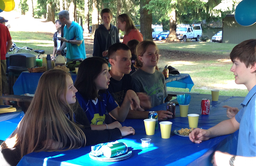

From finishing 2nd at Girls Gen last October with 19 girls taking over the SPARTRONICS Team 4915 to returning to St. Louis for the FRC FIRST Robotics World Championships, it was indeed a "Championship Season."  We celebrated it all with a Pot Luck Cookout at Strawberry Hill Park on Bainbridge, complete with food, festivities to honor our outgoing seniors and something SPARTRONICS are known for: PHUN! Our Fearless Leader Coach Enrique Chee gave each graduating SPARTRONICS Senior a pen and pencil set as a small memento of thanks for their dedication and hard work. Each Senior was also given a piece of "litter" - a Pool noodle, just like the ones we used in Recycle Rush, this year's game. The noodles had the name of each senior painted and marked on the end and everyone signed the noodle: Parents, Mentors and Students. Summer will see the SPARTRONICS at the 4th of July Parade so come out and help us cheer on the Grand Ole Fourth! Photos from the celebration:

