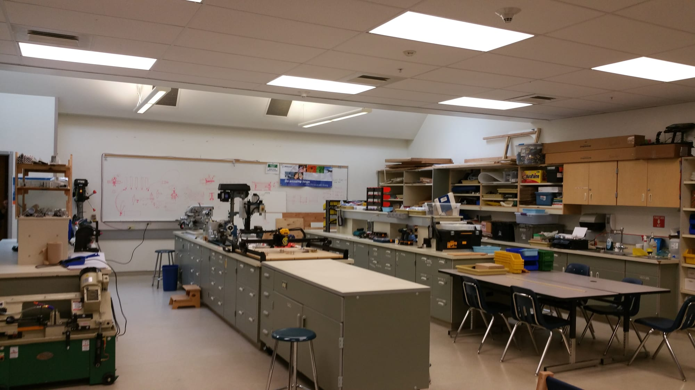
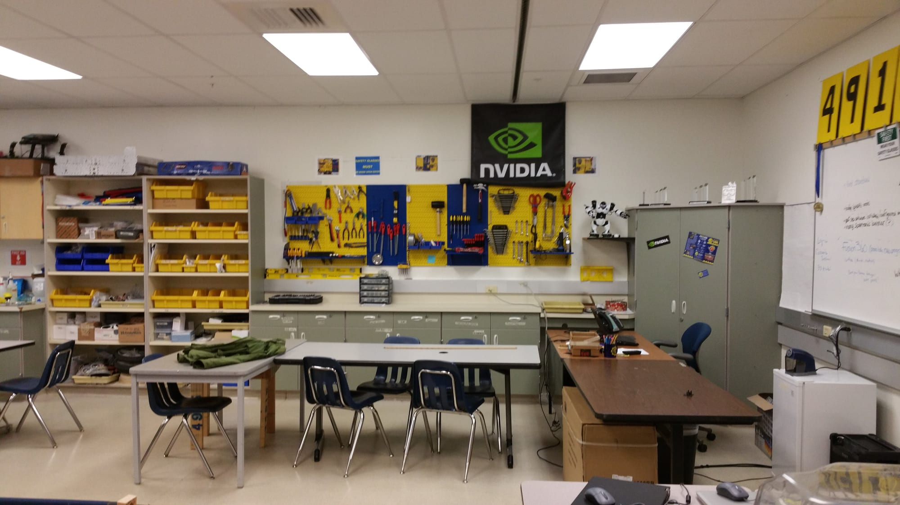
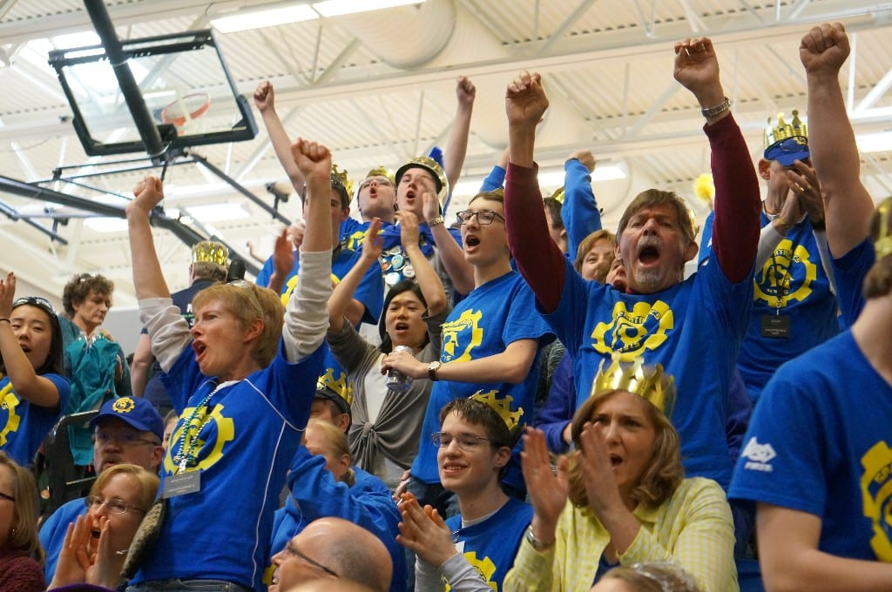

  

## Robotics Room

Throughout time, the number 13 has generally been considered unlucky, but the long-term vision of Spartronics has been to change the way that people look at things, whether it be new opportunities, innovations, and now even the number 13.

While there is no one scientific proof that the number 13 is unlucky, superstition still clings to the number like a thick fog. Whether it be the traditional 13 steps leading up to the gallows, the 13 people attending the last supper, or the number's bad rap may even be owed to the ancient Persians’ 13 astrological year ages, each lasting 1,000 years and the final 13th age, Zodiac, would bring a collapse of the sky and earth, creating a time of chaos.

The number 13 for Spartronics, however, now represents organized dreams and hope itself. Because this year, Spartronics has a new home at BHS -- its own workshop in the room 13 of the 300 building (313). Since our beginning four years ago, our team had to work out of the Coach Chee's already cramped Physics room. Our new Robotics workshop has been a true gift. Over the summer, the theories of chaos and disorder surrounding the number 13 have all but disappeared from the minds of the members of Spartronics as they worked to set up equipment and put everything in the new room in order as we count down to our next build season, starting January 7.  

## 

## How to Become a Spartronics Sponsor to Help Change Student Lives!

Under the direction of Bainbridge High School physics teacher Enrique Chee, FRC Team 4915 Spartronics of Bainbridge Island, WA hit the ground running as an ambitious rookie team in 2013. Spartronics introduced FIRST and FRC to the Bainbridge Island School District. Our team went all the way to the FIRST World Championships in our first two years based on points (see Our History). Today our Island also has 4 FLL and 2 FTC teams, providing FIRST Robotics programs for grades 4th through 12th in just three years!

Help these students fulfill their dreams of building more than robots by becoming a Spartronics Sponsor! You can make a cash donation to the Bainbridge Schools Foundation and 100% of the funds will go to BHS. If you want to help, just send an email to [spartronics4915@gmail.com](mailto:spartronics4915@gmail.com) or if you want to make a financial donation, learn more [here](/support-2/donate/).

If you want your business to become a sponsor, send an email to [spartronics4915@gmail.com](mailto:spartronics4915@gmail.com) and we will contact you further.
