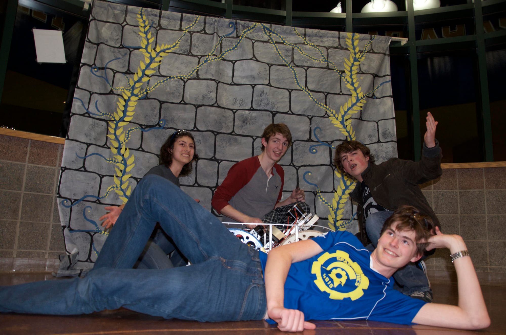

On February 16th, 2016 our robotics team finished our new robot ARES. This robot was crafted to complete the challenges Stronghold presents. On March 12th, we take our robot to our first competition. This competition is at [Glacier Peak High School.](/event/glacier-peak-high-school-event/) We will be competing with 29 other teams to put our robot to the test and see how it performs.

Today our Drive Team spent time practicing the controls and operation of ARES. They have been refining their skills for competition. We hope to perform well and move up in the rankings. Please feel free to support us at [Glacier Peak](/event/glacier-peak-high-school-event/) and watch all the 30 teams perform.

Links

[Event Details](/event/glacier-peak-high-school-event/)

[Competing Teams](https://www.thebluealliance.com/event/2016wasno)
