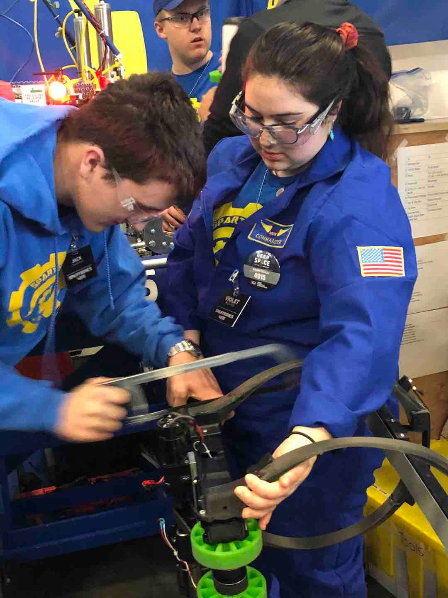
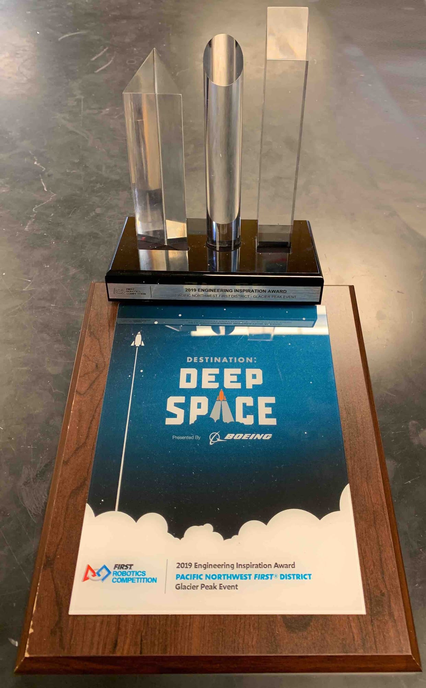
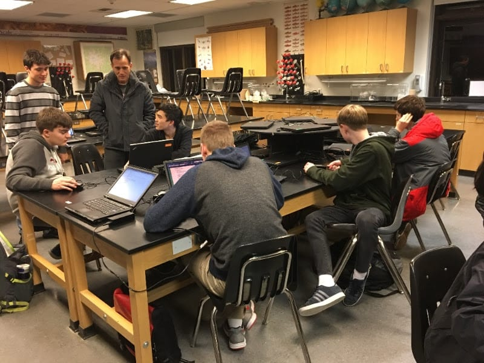

**Glacier Peak Highs and Lows**

Our second District Event Competition was held on March 23-24 at Glacier Peak High School, in Snohomish just south of Everett, Washington. Our matches were filled with extraordinary highs with match play that included our robot CHAOS scored 6 cargo loads in one match and several Level 3 climbs that drew thunderous cheers from the entire crowd.

Once again, we had incredible support from team members, mentors, parents, family member and others who traveled north to cheer us on! As usual, their support was incredible and motivated our drive team - getting them even more excited. Even the announcer's table and the refs were following our team's lead and doing the Macarena to other songs!

But in the end, CHAOS lived up to its name and we did not make it to the elimination matches. And afterwards, we learned that this will be the first time Spartronics robot did not qualify for the District Championship since we do not have enough points to qualify to compete. We finished 4-8 and ranked 28th out of 38 teams competing at Glacier Peak.

However, there was a HUGE surprise as we won a BIG award that could change how our season ends. Read the next story!

**Spartronics HUGE Award at Glacier Peak!**

Despite the heartache of not qualifying with our robot for the District Championships next week in Tacoma, our team's spirits went through the roof when we were awarded the coveted FIRST Engineering Inspiration Award. This is the second highest team honor for the highest competition level in FIRST, second only to the Chairman's Award.

Winning the award qualified Spartronics to compete for the Engineering Inspiration Award at the District Championship in Tacoma next week. The award is highly prestigious, and "Celebrates outstanding success in advancing respect and appreciation for engineering within a team's school or organization and community".

If we win at the district level, our team can move on to compete for the award at FIRST's FRC World Competition in mid-April in Houston, Texas.  
"The team is thrilled with this honor and owes its successes to continued support from Bainbridge Island School District and our amazing Bainbridge Island community," said BHS junior and Spartronics Co-Captain Christopher Mentzer, who is also our team's driver and has been a leader of our Marketing sub team.

**Watch Spartronic on TV: BKAT Features Team 4915!**

BKAT Presents is featured on Channel 12 on Bainbridge Island Comcast and throughout other Kitsap County cable stations, reaching 50,000 households.

This edition of BKAT Presents features Spartronics!

Meet Bainbridge Island High School's robotics team - Spartronics 4915.

Watch our programmers, electricians, mechanics, and marketers gear up for competition in the FIRST Washington robotics program. Co-captain Chris Mentzer gives a behind-the-scenes tour!

THANK YOU BKAT!!!
