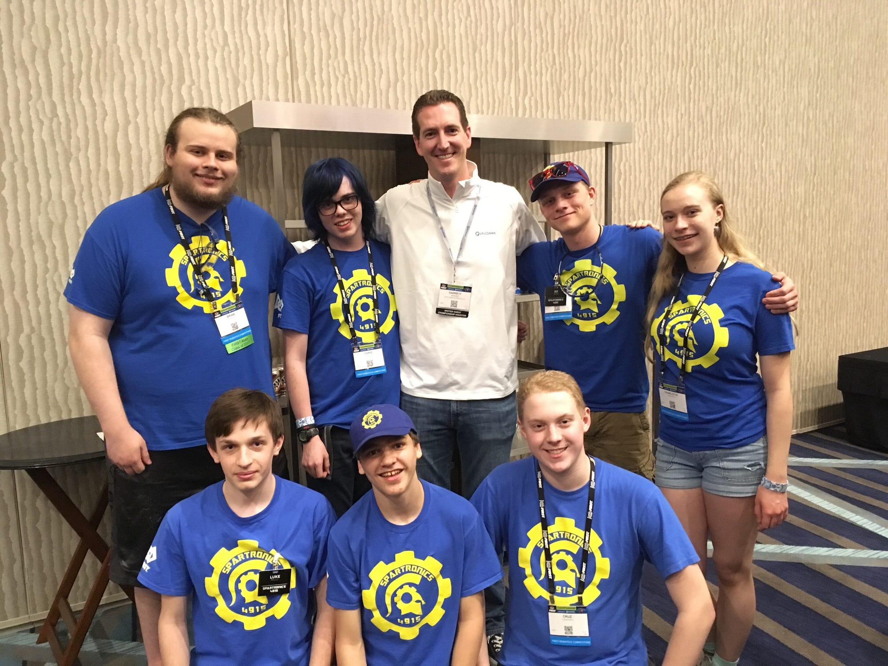
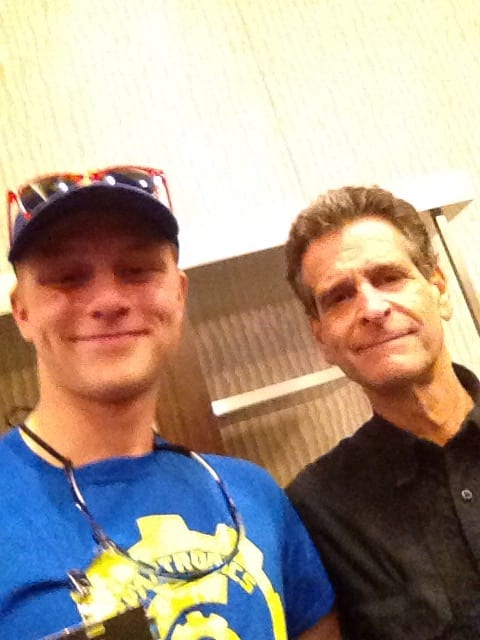
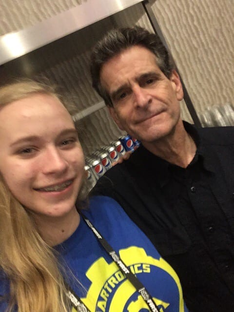
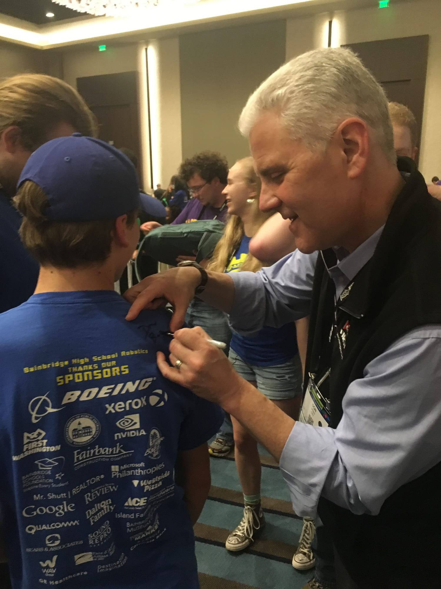
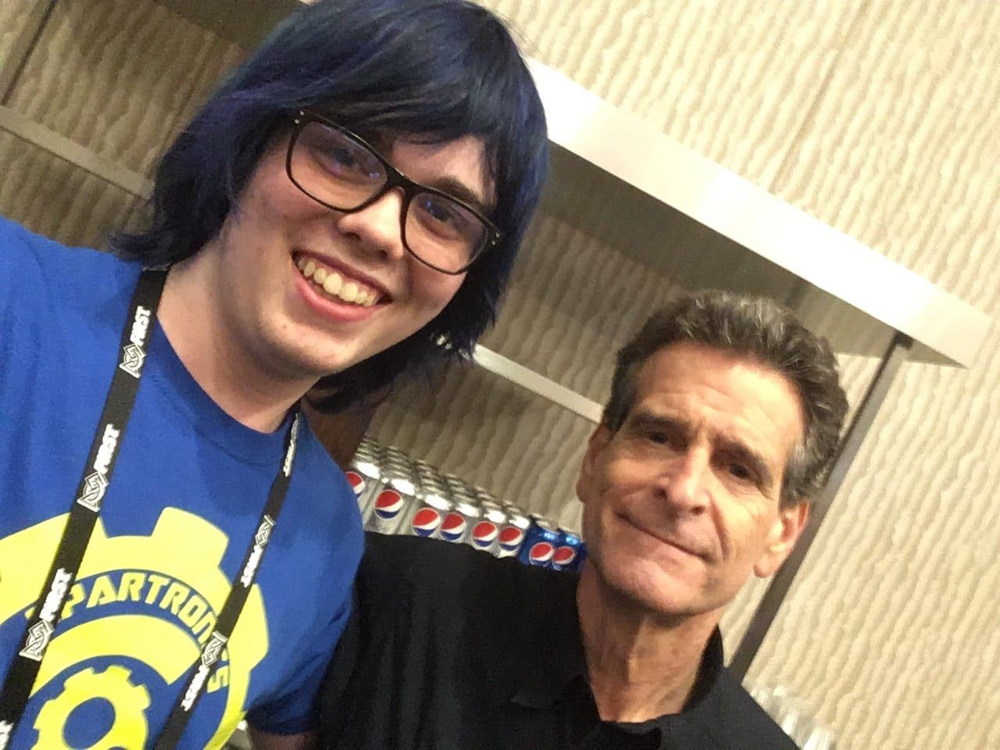
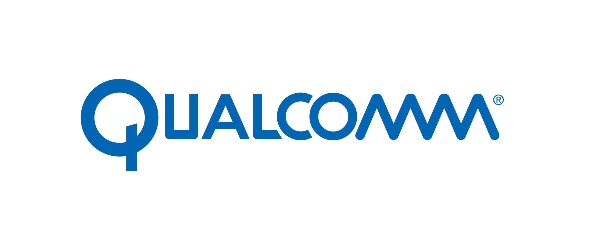

**Qualcomm**, a Sponsor of Spartronics through the amazing local support of Qualcomm's Andy Rimkus, a Bainbridge Islander, invited us to a pizza party Wednesday night at the FIRST Robotics Worlds Championships in Houston.

[Garrett Ponder](https://www.linkedin.com/in/garrettponder/), Senior Manager of Marketing (Strategic Partnerships/Sponsorships) at Qualcomm and a California Polytechnic State University-San Luis Obispo graduate (where we have several Spartronics either headed or alumni attending!) is pictured here with our team members attending the pizza party. Andy knows Garrett, who is based in San Diego.

 And there were some very important VIPs in attendance, including legendary FIRST co-founder Dean Kamen and one of our favorite FIRST people, Don Bossi, President of FIRST, who always seems to find Spartronics at every event he attends that we are at! Below are photos of Dean with team members Bo, Charlotte, and Chris, and Don signing a Spartronics shirt!     Qualcomm is the presenting sponsor of the FIRST World Championships. **THANK YOU QUALCOMM** as you made this a memory for many Spartronics members that they will NEVER forget! 
