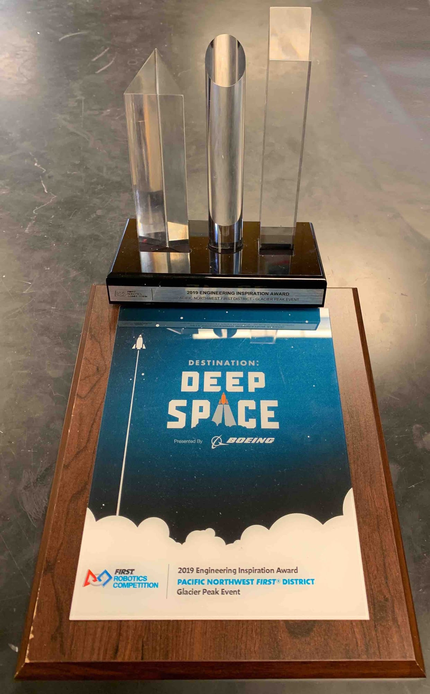

**April 19, 2021**

**In This Issue:**

_**Game Challenges**_

Newsletter by Jessica Rosenfeld

**What have we been up to?**

Spartronics has been busy this season, COVID-19 pandemic and all. This year's competition season is different from anything FIRST and Spartronics has ever seen. Instead of building a robot for a competition, Spartronics has been dutifully tackling the three new challenges from FIRST this year.

**The Challenges:**

**Infinite Recharge at Home**  
This is a way for teams to demonstrate their robot performance and skills at home with last year’s robot remotely and compete for judged awards.

**Game Design**  
Teams must design a new FIRST Robotics Competition game and compete for judged awards.

**Innovation Challenge**  
Teams had to identify a real-world problem, brainstorm a solution, create a business model, and deliver a pitch for judged awards.

_https://info.firstinspires.org/hubfs/2021%20Season%20Assets/GAMECHANGERS/innovation-challenge/gamechangers-frc-short.png_

**Spartronics' Progress in These Challenges**  

Typically, Spartronics works in subteams, including Business and Marketing, Electronics, Programming, Mechanics and Fabrication, and Design. For the 2021 Season, Spartronics has divided into three different teams to conquer the challenges.

Each subchallenge has cleared the first round of judging. The Innovation Challenge found out on April 16, 2021, that they did not proceed to the semi-finals, and, soon, FIRST will notify us if the other teams have qualified for semi-finals.

If any of our teams make the semi-finals, they will have to create additional content related to their challenge, all within an extremely short time frame.

**Annual Open House!**

Our sincerest apologies for the lack of communication this year, but the best news is that Spartronics will be having a virtual Open House this year, May 19th from 6-8 pm. We hope to see you there! More details to come.

_https://www.cellebrite.com/en/going-virtual-a-look-back-at-cellebrites-annual-connect-global-summit-2020/_
