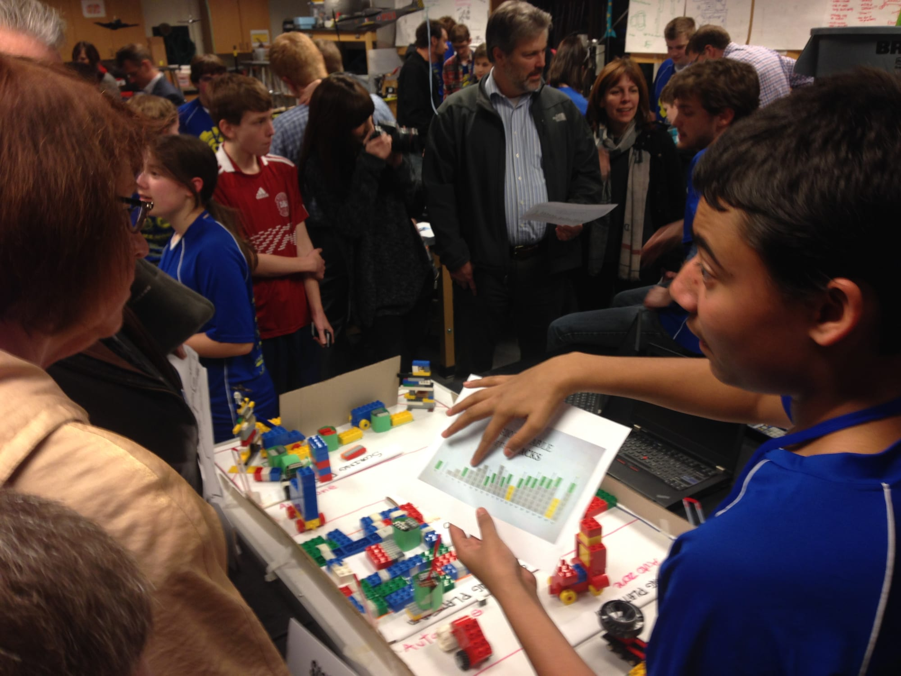

# 500+ People Attended!

THANK YOU TO EVERYONE WHO SUPPORTED US ON BEHALF OF

**BHS ROBOTICS - SPARTRONICS 4915**     

Thank you for attending our 2nd Annual Community Open House that showcased STEM and Robotics on Bainbridge Island. We had more than 500 people attend: That's double last year's first Open House attendance!  We had teachers and students of all grades, community members of all ages, our family and friends and many leaders of our school and community. We also had many of our SPONSORS and we would not be where we are today without your financial support so thank you: **Ace Hardware of Bainbridge Island, Bainbridge Island Destination Imagination, Bainbridge Island School District, Bainbridge Schools Foundation, Boeing, BuyBainbridge.com, Eagle Harbor Asset Management, Inside Bainbridge, the Lugouri Family, Mr. (Jason) Shutt, Office of the Superintendent of Public Instruction, Olympic Property Management, Raytheon, SEARS & ASSOCIATES, Solidworks, Stewart Title of Kitsap County, Town and Country Markets, Westside Pizza** and **Windermere Real Estate Bainbridge Island**. We are nearly 50 students, more than a dozen mentors and a tireless Coach and are so proud to share what we have been doing since September in planning and for the last six weeks in building our robot.  We were very proud to show GAEA, our new robot, before our [FIRST FRC district competitions](http://spatronics4915.us9.list-manage.com/track/click?u=83401ef6f6634dd529783840a&id=17d777fc42&e=81680b0c0c) which begin soon. It really has been the “hardest fun we’ll ever have,” and we are so glad you were able to meet our programming, mechanical, electrical, pneumatic, 3D printing and CAD, rules and marketing subteams, as well as our FIRST FTC middle school teams and the robots they built for their Rookie season. **AGAIN, THANK YOU FOR YOUR INCREDIBLE SUPPORT AND PLEASE JOIN US AT A COMPETITION TO SHARE IN THE EXCITEMENT.** **GO SPARTRONICS!**
