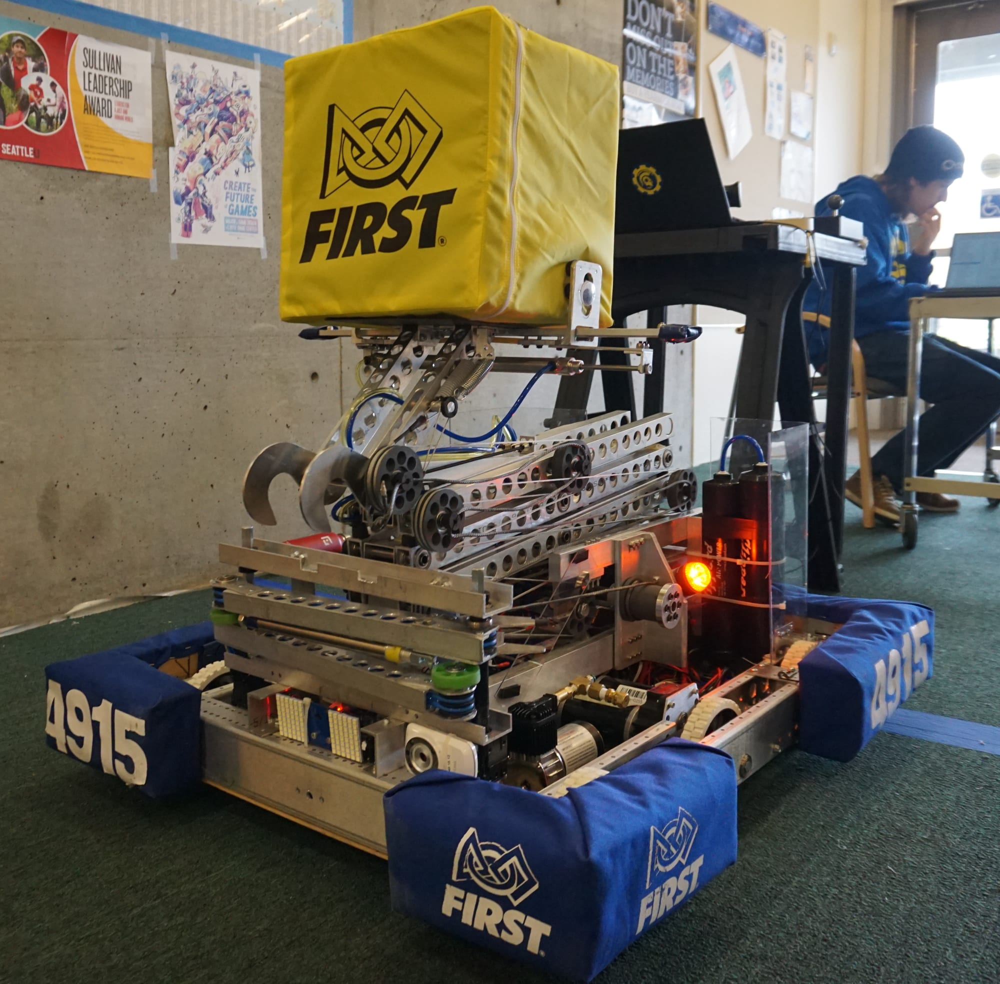

Please join us at our upcoming Open House, on Wednesday March 14, showcasing STEAM and Robotics on Bainbridge Island. We want as many teachers, students of all ages, family members, parents, and community members to see STEAM and Robotics in action as is possible!

Our six‐week robot build season for Spartronics Team 4915 -- which is composed of 55 students, 17 professional mentors, and Coach Chee -- ended on Feb. 20. Meet THEMIS, our new robot!

We'll share what we've been doing while having the “hardest fun we’ll ever have.” You’ll meet our programming, mechanical, electrical/pneumatic, CAD, strategy, and marketing sub-teams. Plus you can also see what the Islands FTC middle school teams, and potentially its FLL elementary/intermediate school teams, have been doing this past season!
