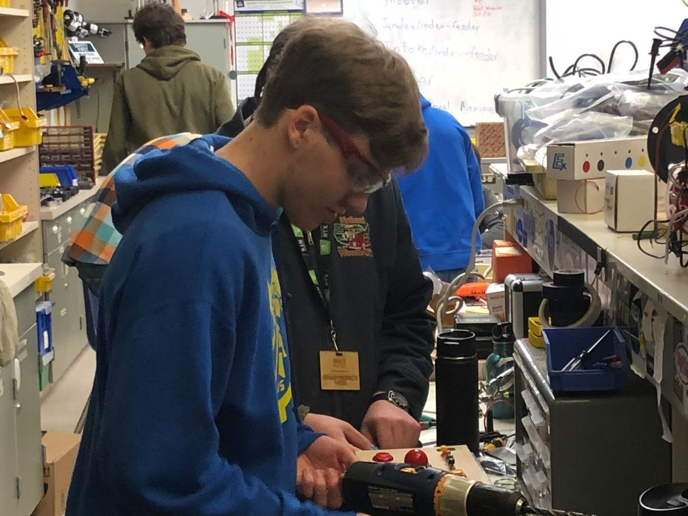
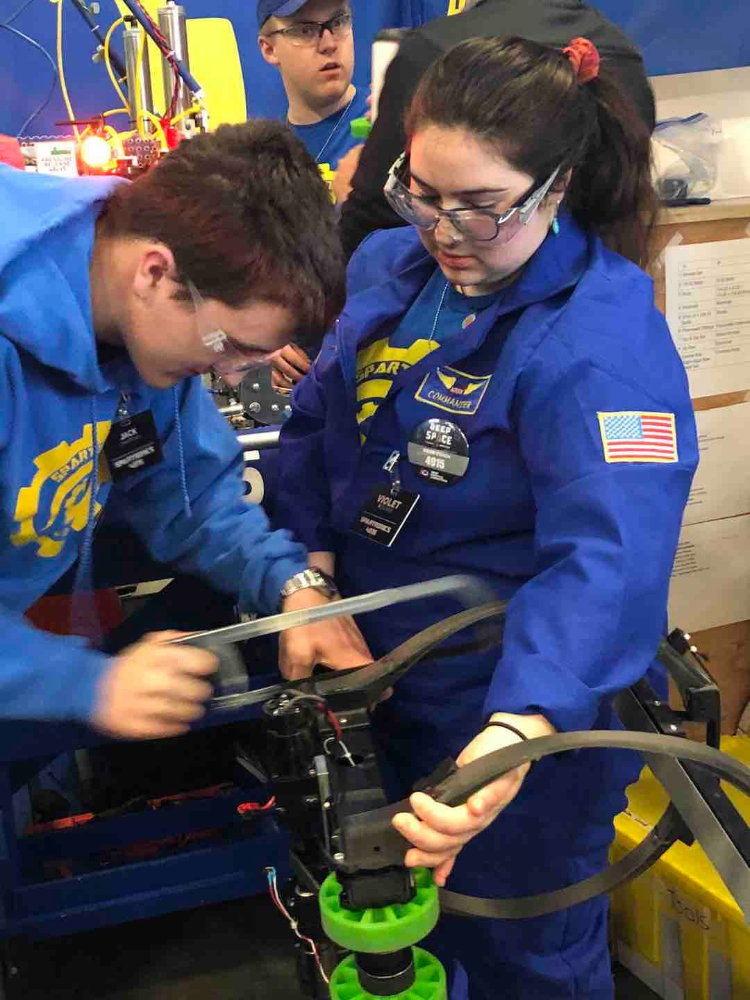

**Subteam Updates**

As our 2020 build season marches on every Spartronics subteam has kept busy in spite of the unexpected snow.

Mechanics subteam is finishing building this year's field elements out of wood. They are also making bumpers for our new robot. The shooter for the Power Cells is being prototyped to make sure that it can shoot the correct distance before being manufactured.

The Programming subteam is still training students, and have just assigned team members specific robot subsystems to people to develop. Programmers are also testing different sensors and computer vision that will track where to shoot the Power Cells. This is primarily done with Visual Simultaneous Localization and Mapping.

The Electronics subteam is working with [NEO motors](https://spatronics4915.us9.list-manage.com/track/click?u=83401ef6f6634dd529783840a&id=634ad65ff7&e=96dbbba0fa) and researching ultrasonic proximity sensors. These sensors measure distance.

Our Marketing subteam has finalized the artwork for new sponsor banners and team shirts as well as created flyers and ads to promote our annual "All Robotics  Open House," scheduled for March 25th.

**Sponsor Spotlight: Cavu Networks**

  

[Cavu Networks](https://spatronics4915.us9.list-manage.com/track/click?u=83401ef6f6634dd529783840a&id=abe74f2e61&e=96dbbba0fa) was founded in 2004 and has been providing its technical expertise to the Seattle area ever since. As they're also a valuable sponsor to Spartronics, we decided to ask founder John Brennan a few questions about the company.

**Spartronics**: Can you give us a brief description of Cavu networks and what it does?

**John:** Cavu Networks provides I.T. management and consulting services for small businesses. We help our customers by providing clear, actionable and valuable services as their the trusted partner for all things I.T.

**Spartronics:** Why is Cavu Networks sponsoring Spartronics?

**John:** We love to tinker with technology at Cavu so it is inspiring to see the students learn through hands-on experiences building their science, engineering and technology skills. The dedication to hard-work of the students and mentors is easy to see. And, they have fun!

**Spartronics:** Is there a way Spartronics fans can support your company?

**John:** If your business has questions about technology planning, security and compliance, or in need of some I.T. assistance, please get in touch with John Benjamin. Drop-by our offices at Coppertop anytime, sign-up for our newsletter on our website, and like our Facebook page. There is almost always an office dog such as Lucie to greet you.

**Spartronics:** Is there anything else you would like us to include in your Sponsor Spotlight newsletter feature?

**John**:

John Benjamin – 206-866-5340

blog: https://[www.cavunetworks.com](https://spatronics4915.us9.list-manage.com/track/click?u=83401ef6f6634dd529783840a&id=464e6d470d&e=96dbbba0fa)/blog

Facebook: [https://www.facebook.com/Cavunetworks/](https://spatronics4915.us9.list-manage.com/track/click?u=83401ef6f6634dd529783840a&id=0910bc2c48&e=96dbbba0fa)

