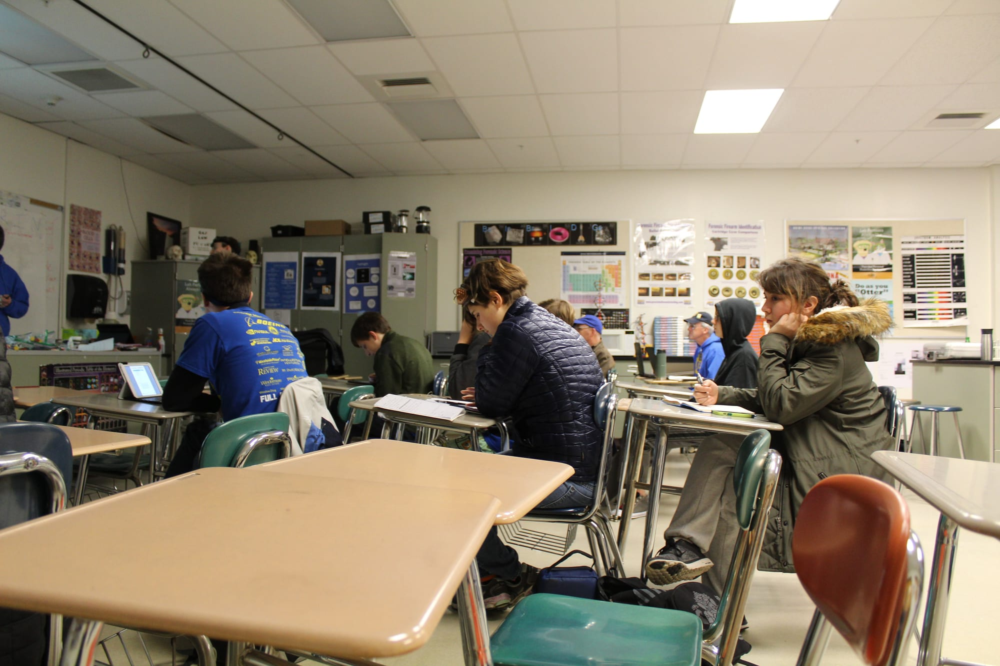
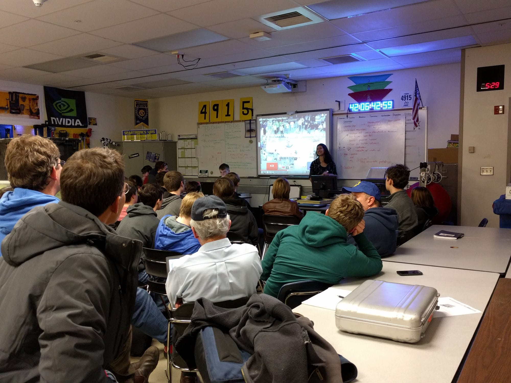
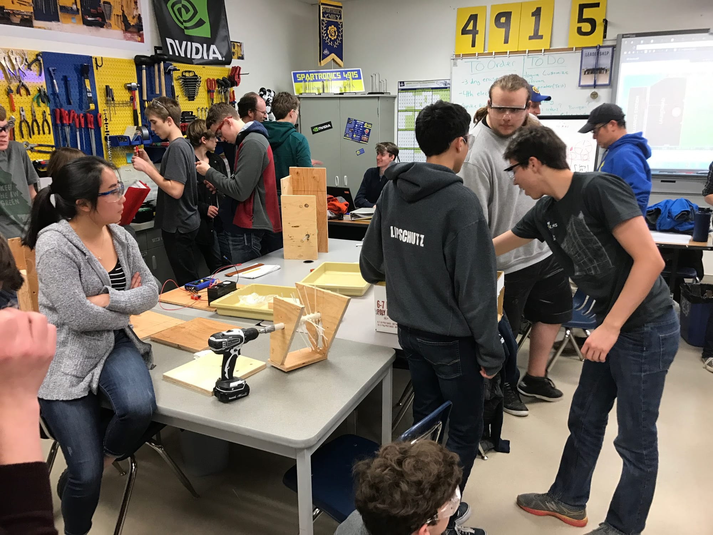

**Our strategy choice process:**  
As the details of the game were revealed in the eagerly anticipated kickoff video last Saturday, the team moved from mock design, to the real thing. In groups of 12 to 13, team members assembled into groups, brainstormed for several hours, and came up with an original and individual design. After a day of design meetings, all the suggestions were presented to the entire team. After long and in depth deliberations, there was a survey sent to all team members and mentors regarding which aspects of each design should be used for this year's robot.

**Our strategy decision and justification:**  
Although it was a close call, the decision was made that this year’s robot would be a shooting robot. The shooting robot will score points by propelling or launching fuel (wiffle balls) into the two openings of the boiler, low as well as high. A shooting robot is an alternative to a gear robot, one which retrieves and delivers gears to the middle airship to score points in a different way. The team came to this decision by recognizing that the shooting feature will be able to obtain more rank points, compared to the match point point focused gear design.

**Our current mechanical ideas:**  
Every subteam is buzzing with discussion and deliberation on what must be incorporated into this year’s robot and what can be left off. Over the past years, our team has discovered that it is easier to create a functional body and modify it as opposed to making many working parts and trying to tie them all in together. All of the subteams are going through their processes and working together to create a successful and functional robot that can meet the challenges of the exciting game this year – STEAMworks
