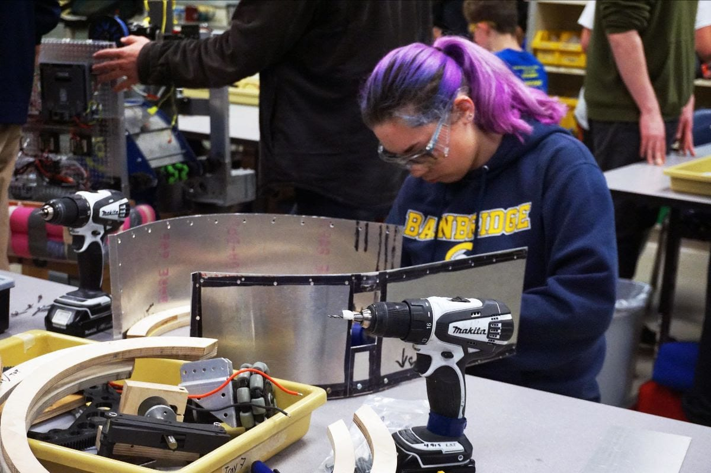
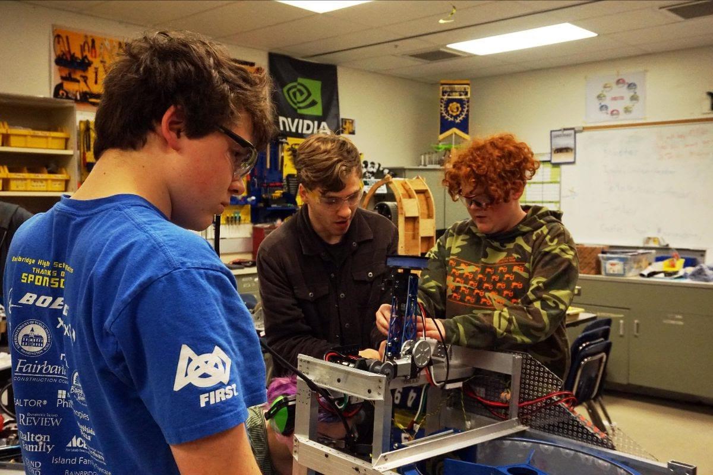
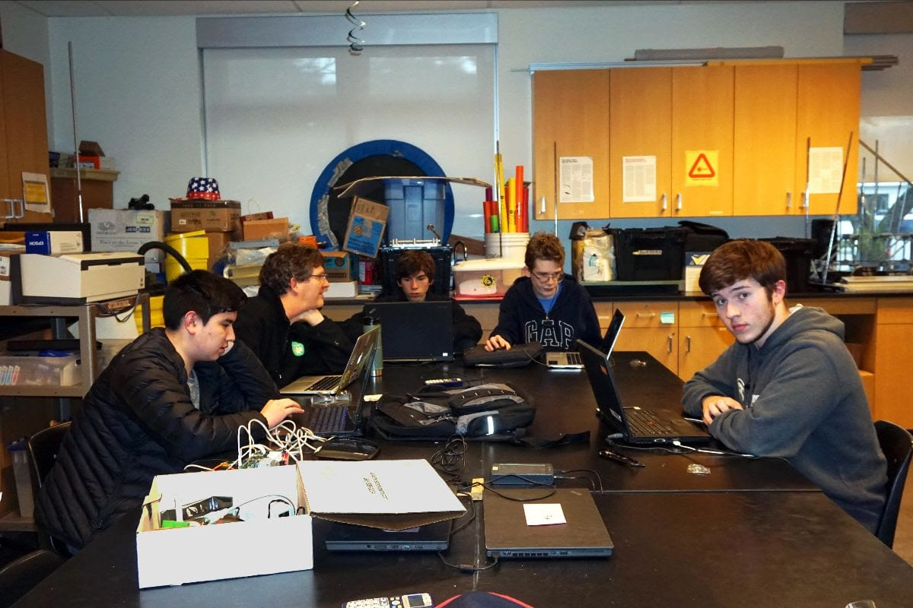
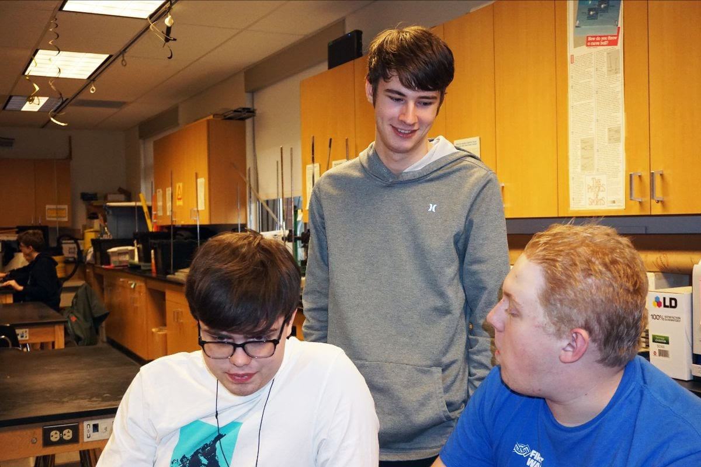
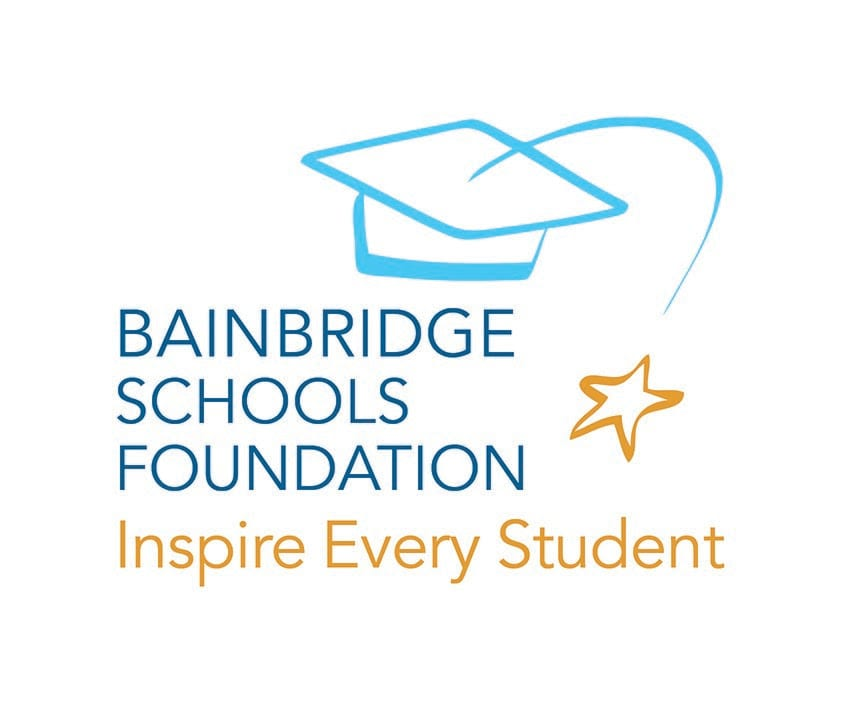
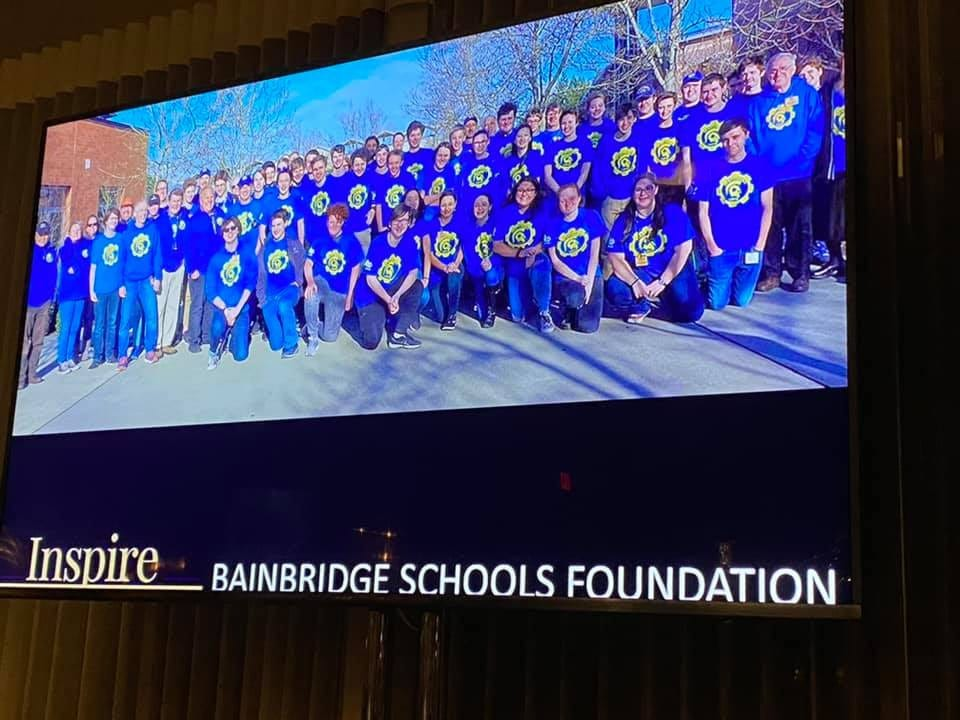

Our new robot is coming together as we enter Week 5 and the home stretch of our 2020 Build Season. The **Mechanics** are working hard to complete the robot. The mechanisms are being finalized and assembled. The goal is for the robot to be fully assembled this week. Spare parts are also being ordered.

**Marketing** is continuing planning for our All-Robotics Open House on March 25th, beginning at 5:00 pm in the Bainbridge High 300 building. They have also finished and submitted the essay for the [Chairman's Award](https://spatronics4915.us9.list-manage.com/track/click?u=83401ef6f6634dd529783840a&id=e2106b171c&e=96dbbba0fa) essay. Next up: we are developing the Chairman's Award presentation and video. We will present these to present to the Judges at one of our competitions. The Chairman's Award is _FIRST's_ most prestigious award, honoring a team "that best represents a model for other teams to emulate and best embodies the mission of _FIRST."_ **Electronics** is readying for the robot to be finished. They have been organizing all of the parts for the electrical systems, which will help them get the robot done faster and more efficiently once Mechanics complete their work. The electronics board is already mounted on the robot. Electronics has also run the wiring for the control panel mechanism and the intake. **Programming** is finalizing the subsystem commands for testing, and they are eagerly awaiting Mechanics to give them the robot. They have been using a new simulator to test color identification, which is one of the challenges of our 2020 game, [Infinite Recharge](https://spatronics4915.us9.list-manage.com/track/click?u=83401ef6f6634dd529783840a&id=e0af3706d0&e=96dbbba0fa). **Design** team has finished the shooter design. They are currently working on finalizing the hook, camera mounts, sensor mounts, and extendable intake. The shooter prototype just shot a mock power cell about 50 feet!

**_Stay tuned for our next issue of this newsletter as we will unveil our new robot -- and its name!_**

**Sponsor Spotlight: Bainbridge School's Foundation**  **Q**. Can you give us a brief description of your company and what it does? **A.** The Bainbridge Schools Foundation brings the island together to invest in exceptional learning, innovative programming and key initiatives that strengthen the educational experience of each Bainbridge Island School District student. Because state and federal funding falls short of what our students and teachers need, funding through BSF fills the gap. BSF relies on community support to make this work possible.  _Photo: BSF showed their support of Spartronics at their recent annual fundraising gala_ **Q**. Why is Bainbridge Schools Foundation sponsoring Spartronics? **A**. With our ongoing focus on innovation (one of our three funding areas), BSF and Spartronics are natural partners. We’re proud to be long-time supporters of BHS Robotics and are pleased to be able to help the team. **Q**. Is there a way Spartronics fans can support your company? (i.e. "Like" your Facebook page, tell others about your business, buy your product or services, etc.) **A**. Yes! Spartronics fans can follow our page on Facebook (BSFoundation) or Instagram (BainbridgeSchoolsFoundation). Please visit our website ([thebsf.org](http://thebsf.org/)) for more information about what we fund, how you can get involved, or to make a donation in support of our public schools. **Q**. Is there anything else you would like us to include in your Sponsor Spotlight newsletter feature? (i.e. someone's contact information or link to a website or social media info, etc.) **A**. BSF funds support every student, every day. Among other things, donations to BSF fund  STEM Lab classes, which help elementary school students of today develop into the Spartronics team members of the future!
