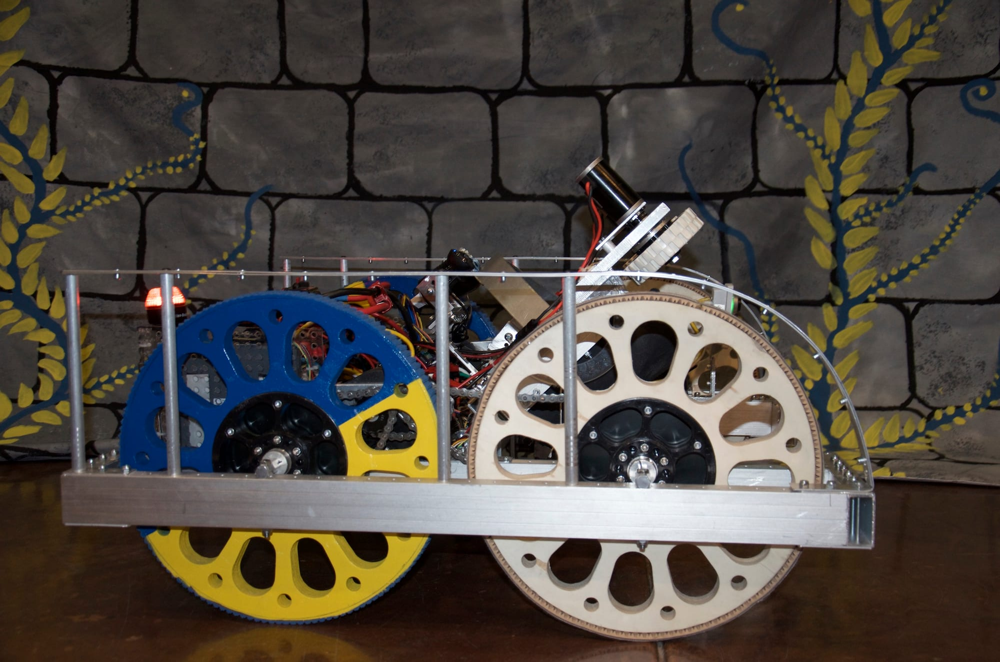

Meet [ARES](/about-2/our-robot/ares-20152016/): our newest robot for the 2016 Competition and the FIRST FRC game STRONGHOLD. ARES stands for _Advanced Robot Engineered for Siege._ Most importantly, ARES makes its debut TONIGHT, Wednesday March 2, 6-8:00 p.m. at Bainbridge High School during our Community Open House.

Everyone is welcome, there is no admission charge and there will be free refreshments!

You'll also meet other robots from our four FIRST Lego League and two FIRST Technical Challenge teams as Bainbridge Island now has robotic teams for grades 4th through 12! See how we all are building more than robots: We are building great futures -- all because of the support from our community.

So join us!

Just follow the signs and we will see you there.
