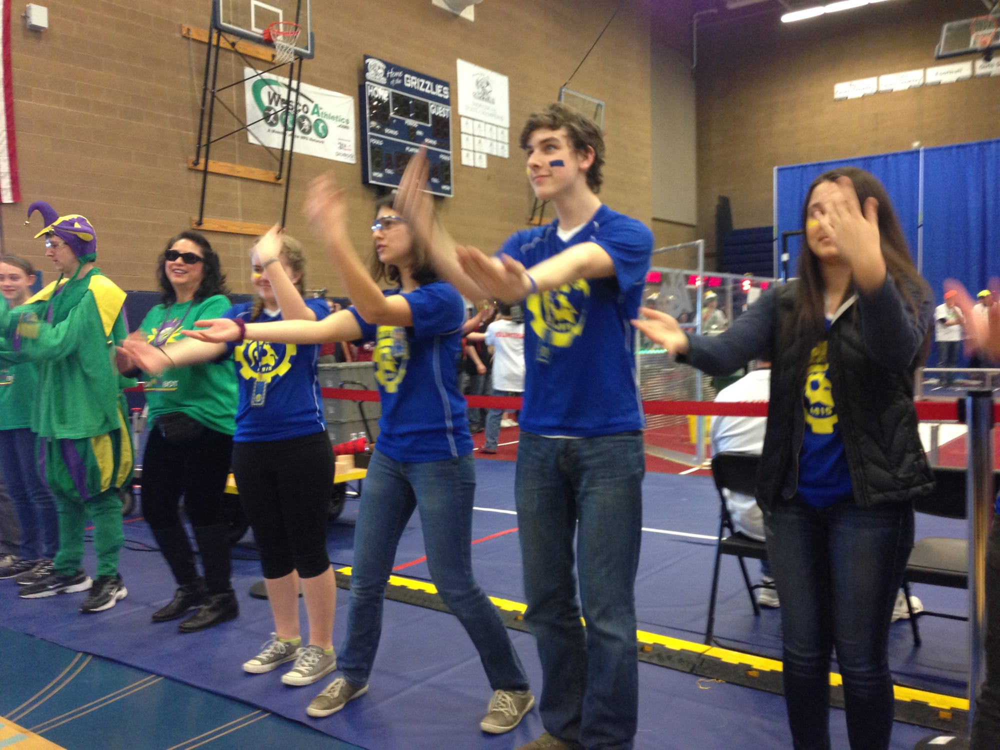

It's Spring and on Saturday we enter our 2nd competition at Shorewood High in Shoreline, WA and competing with other robotics teams in the region. If you are unable to make it, FIRST livestreams the entire event (see link below). Be sure to check social media and our website for live updates from the team!

Information: Match Results & Ranking (see schedule below)

[http://pnwfirst.org/events/schedule/2015-pnw-dist-8/](http://pnwfirst.org/events/schedule/2015-pnw-dist-8/)

[  
Shorewood Livestream](http://pnwfirst.org/events/schedule/2015-pnw-dist-8/)  
[https://spartronicsbhs.wpengine.com/events/](http://pnwfirst.org/events/schedule/2015-pnw-dist-8/)

More information  
[http://www.usfirst.org/whats-going-on/event/10853](http://spatronics4915.us9.list-manage.com/track/click?u=83401ef6f6634dd529783840a&id=638bfaa565&e=81680b0c0c)

**2015 Pacific Northwest District**

**Week 4 Shorewood SCHEDULE**

_**Friday, March 20, 2015**_

5:00 PM – 10:00 PM Pits Open and Robot Inspection begins

**_Saturday, March 21, 2015_**

8:00 AM Pits and Machine Shop open

8:00 AM – 10:00 AM Registration and Robot Inspection Continues

8:30 AM – 10:00 AM Practice Rounds

10:30 AM Opening Ceremonies

10:30 AM – 11:30 AM VIP Tour and Open House

10:45 AM – 1:00 PM Qualification Matches

1:00 PM – 1:30 PM Lunch

1:30 PM – 7:00 PM Qualification Matches

8:00 PM Pits and Machine Shop close

_**Sunday, March 22, 2015**_

8:00 AM Pits and Machine Shop Open

8:30 AM – 9:00 AM Opening Ceremonies

9:00 AM – 10:30 AM Qualification Matches

10:30 AM – 11:00 AM Alliance Selection

11:00 AM – 11:30 AM Lunch

11:45 AM – 3:00 PM Final Rounds

3:00 PM – 4:00 PM Awards Ceremony

4:00 PM Pits Close

_\*\*Schedule subject to change. All times are estimated based on flow of rounds._
