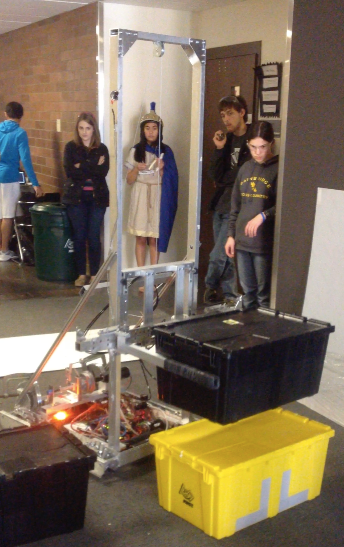

Just two more days before the "Bag and Tag" of our new 2015 competition robot GAEA - which means we stop working on our robot until our first event competition in early March.

Today, on Sunday, February 15 the driving team continued testing GAEA, which successfully navigated the quick stacking of several totes with it's unique arm and lift system.

Come see GAEA for yourself at our Open House on Wednesday, Feb. 25, from 5 pm to 7 pm. Everyone is welcome!  See [details here](/support-2/open-house/).
