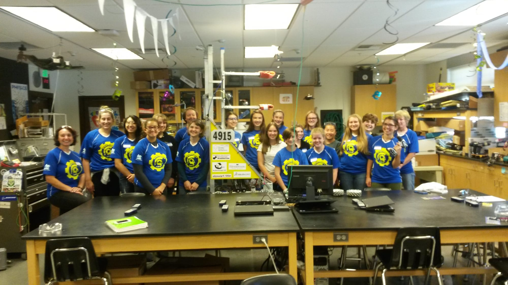
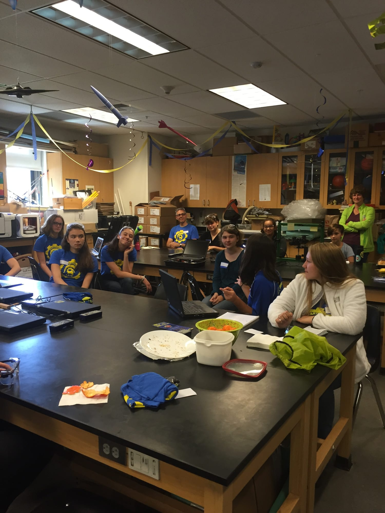

_Girls Generation Team - 2015_

_Hard at work!_

While the regular competition season is still several months away, the physics classroom at Bainbridge High School is once again buzzing with robotics activity. Girls Generation, the competition that is run completely by girls, takes place on October 17th.  Spartronics 4915 is sending 19 girls to compete this year. Last year, our first year of Girls Generation, we achieved 2nd place. Stay tuned for more details! GO GIRL POWER!

**Girls Generation:**

When - October 17th, 2015

Where - Tahoma High School in Covington, WA
