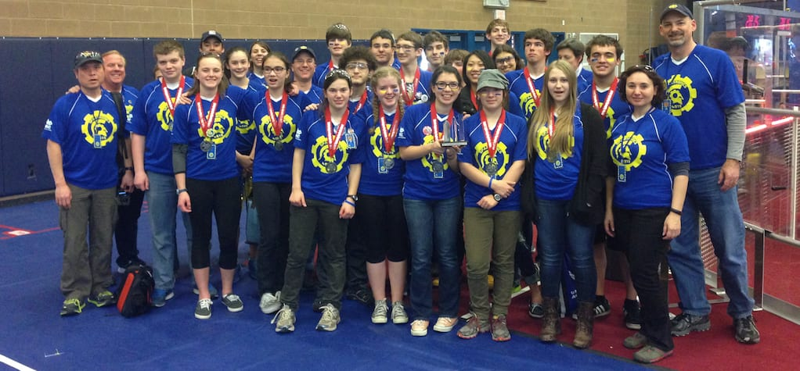
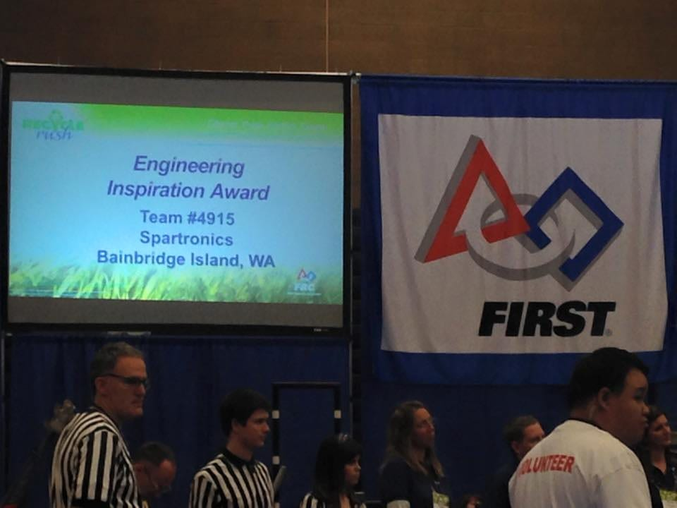

Spartronics Team 4915 won the highly coveted "Engineering Inspiration Award" this weekend at Glacier Peak High School District Event. The award automatically qualifies the Team to attend the **[Pacific NW Championship](http://www.usfirst.org/uploadedFiles/Robotics_Programs/FRC/Events/2015/2015_PNCMP_SiteInfo.pdf),** April 1-4, Eastern WA University, in Cheney, WA.

See Spartronics win the award here: [http://youtu.be/WTsauG-a5NY?t=38m35s](http://youtu.be/WTsauG-a5NY?t=38m35s)

We still need to qualify by points to compete with our robot, GAEA, but we along with winners of each District Event will compete for the PNW (Oregon and Washington) "Engineering Inspiration Award." The winner of the District Award will go to the Worlds in Saint Louis later in April.

We also placed 10th overall at Glacier Peak, and are now ranked 29th in the PNW. The top 64 Teams go to the PNW dual-state tournament.

The Award is the second highest honor that our team could win and will give the team bonus points.  This award celebrates a team’s outstanding success in advancing respect and appreciation for engineering and engineers, both within their school as well as their community. Criteria include: the extent and inventiveness of the team’s efforts to recruit students to engineering, the extent and effectiveness of the team’s community outreach efforts, and the measurable success of those efforts.

All the award winners from Glacier Peak [are here](http://pnwfirst.org/events/schedule/2015-pnw-dist-8/).
