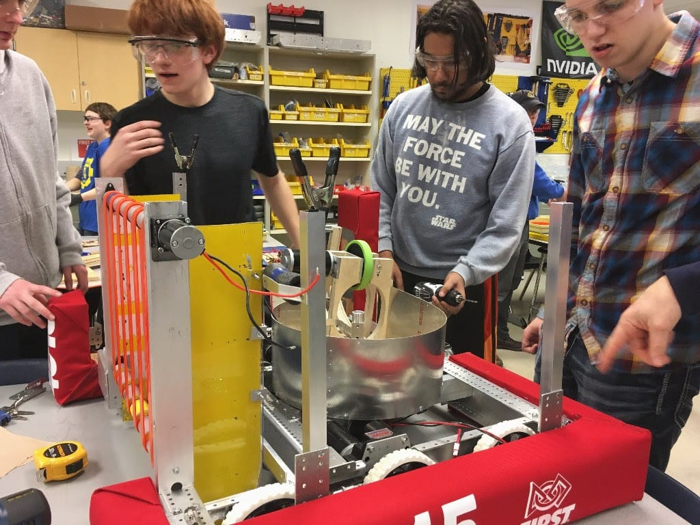
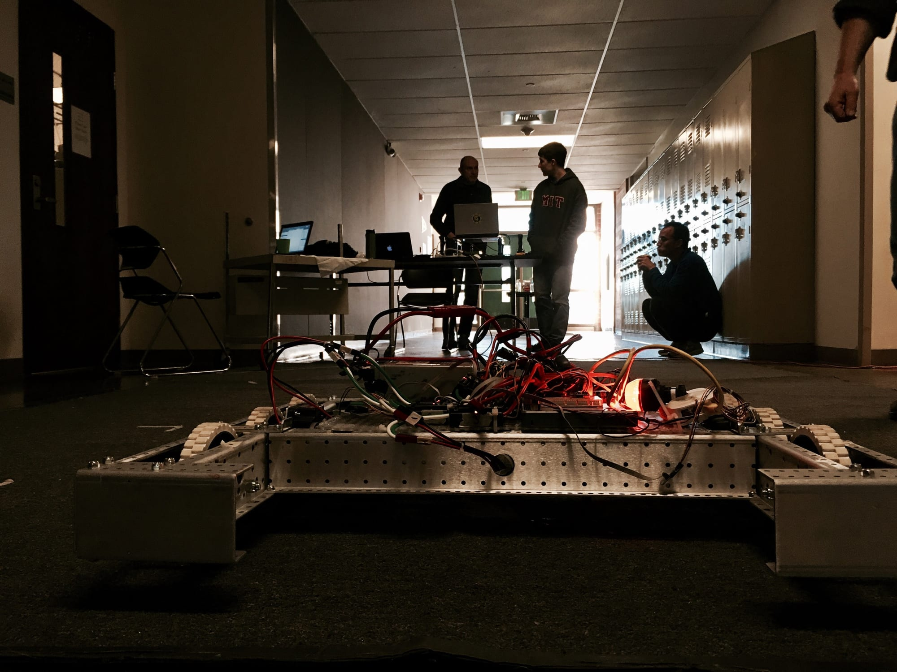
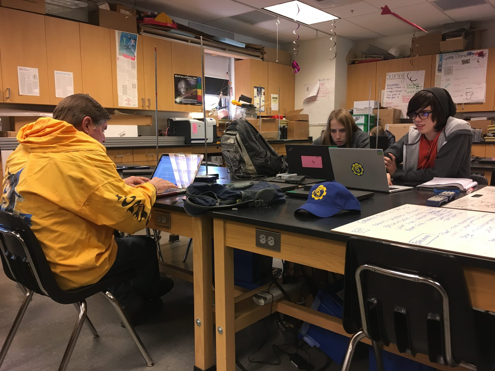

## What’s up with Mechanics?

Our Spartronics Mechanics are hard at work as ever, and they finish the agitator! The agitator is the module which will launch the balls into goals for points during the competitions. Its assembly is basically completed and the mechanics are currently working on making extra fins for this mechanism along with adding the storage and stabilizers to it. The launcher component is now shooting consistently well, and we are very optimistic about how it will do in competitions!

Our climber is still a work in progress as the mechanics are working through some kinks with the climber dimensions of the robot at the moment.

## What are those crazy programmers doing?

Our Programmers have just finished coding the launcher on/off function and it is running smoothly! They are very happy with the result! Shooting the launcher so far has been going smoothly as well- the robot has shot three consecutive rounds that did as well as we wanted! Their next task is to start on the agitator and continue to work on the launcher. Our Programmers have also figured out how to turn at an angle with the robot. For the autonomous portion of the game, they have partially finished the coding. They generate this code by driving the robot as how they will during the competition, and recording that action as a code. The data is saved and can be used later. Our Programmers have also figured out how to turn at an angle with the robot.  

## And the Marketers?

The Chairman’s Award is one that recognizes how a team promotes the values of FIRST and does community outreach. We’ve finished the Chairman’s essay and turned it in! This award has three parts: essay (done!), presentation, and video. The later two are currently in progress and will be done soon. Marketers are also working on the annual Spartronics Open House! It's March 15, so save the date if you haven’t already! We have been promoting this event so help us out: tell a friend. We can’t wait! Hats, hoodies, and Team Shirts have been designed and ordered for our team, and they will be arriving on Bag Day - Tuesday, Feb. 21.
