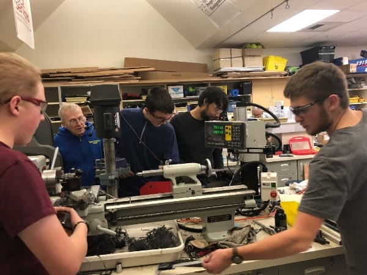
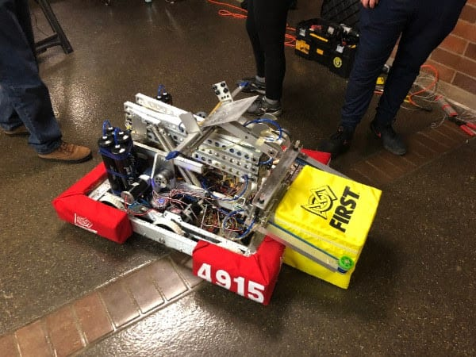
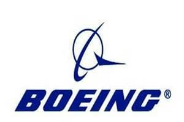

**Subteam Updates:**

**Mechanics** and **Electronics** have completed 2018’s first robot! This year, it was decided that Spartronics will build two robots. The second robot will allow drive team to practice with a robot even after the one we’ll use for competitions is sealed on Bag Day. For those not in the know, Bag Day is when every FRC team in the world is required to stop building their robot and pack it away in a sealed plastic bag, in preparation for the competition season.

With the first robot handed off to programming, Mechanics and Electronics have both begun work on the second. The robots this year incorporate pneumatics in every module, more than other robots we’ve constructed in the past. This has allowed members of the electronics subteam to learn a lot about pneumatics, both from mentors and independently. In addition to building the second robot, mechanics and electronics are creating spare parts for the robots.

**Programming** has been making full use of their time with the robot. Every subsystem has been completely programmed, and the scissor lift is completely tested. They’ve also set up all the robot’s driver controls.

The **Marketing** subteam is continuing preparations for our 5th annual all-Island Robotics Open House, due to be held on March 14th. They’ve has also begun to pack the trailer the team will use at competitions. The new banners for the Pit have been ordered as have our 2018 Sponsor banners. Finally, marketing has received this year's teams shirts, hats, and hoodies and will start distributing them soon!

There also will be a BIG celebration at BHS on Bag Day night that Marketing will help host!

**Robot Name Reveal:**

Spartronics Team 4915 is excited to announce the name for this year's robot: **THEMIS**!

The acronym is **THE** **M**echanical **I**ntake **S**cissor-Lift. The name also continues the Spartronics tradition of naming robots after Greek mythological figures.

Themis was the Greek God of Divine Order, Fairness, and Law. These aspects of the goddess align very well with FIRST’s own values of coopertition and gracious professionalism. The Scales of Justice, Themis’ symbol, also relate to this year's game and its scale game element. We eagerly await seeing how THEMIS will do in competition season.

**Sponsor Spotlight:** **Boeing**

Since being founded in Seattle in 1916, [Boeing](https://spatronics4915.us9.list-manage.com/track/click?u=83401ef6f6634dd529783840a&id=b2dd73dc39&e=96dbbba0fa) has gone on to become the world's preeminent aerospace engineering company. As a corporation whose success is based on technological and scientific excellence, Boeing understands the value of FIRST and its message. They demonstrate this understanding every year with their support of Spartronics.

Our biggest sponsor, Boeing has donated tens of thousands of dollars to the team over the years! This history of support stretches all the way back to 2013 with one of our founding mentors, Jon Sachs, being a Boeing employee. Jon and our other Boeing mentors, Jim Carr and Randy Groves, have collectively spent hundreds upon hundreds of hours with Spartronics.

We want to extend our thanks to everyone working at Boeing, with special emphasis on our incredible Boeing mentors!

**This is Jon's Story:**

Below is the latest in a series of "Student Story" videos we've created to show how donations from sponsors like Boeing make a huge difference for every student.

<iframe src="https://www.youtube-nocookie.com/embed/IBj30Yb-pUA" title="YouTube video" allowfullscreen="" loading="lazy"></iframe>
