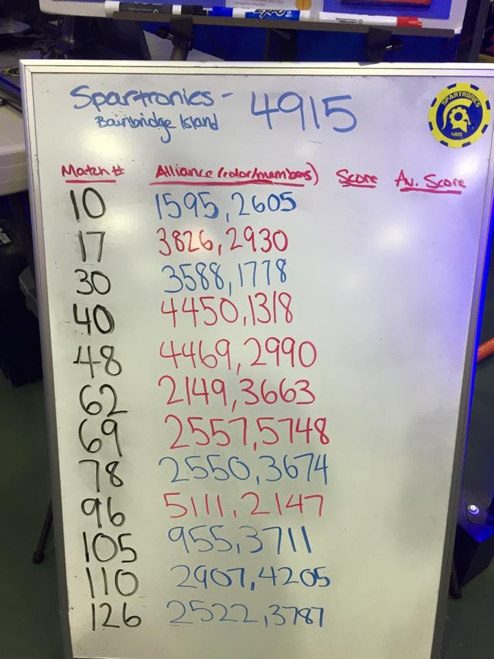

After 3 matches on Thursday, Spartronics sits at 21st in the regional competition. See live ranking of our event here:

[http://frc-events.usfirst.org/2015/PNCMP/rankings](http://frc-events.usfirst.org/2015/PNCMP/rankings)

The regional competition hosts the top 64 teams in the Pacific Northwest Region. Spartronics posted a qualification average of 114.00, our highest ever! To watch more Spartronics coverage, see the link below.

FRC Livestream

[http://www.ustream.tv/channel/pnwfirst-red](http://www.ustream.tv/channel/pnwfirst-red)  

## Event Schedule

 **Wednesday, April 1, 2015**

Pits Open and Robot Inspection begins

5:00 PM – 9:30 PM

 **Thursday, April 2, 2015**

Five (5) Team Reps Load-in for late arrivals

7:45 AM

Pits and Machine Shop open

8:00 AM

Registration and Robot Inspection Continues

8:00 AM – 12:00 PM

Practice Rounds

10:00 AM – 12:30 PM

Lunch

12:30 PM – 1:30 PM

Qualification Matches

2:00 PM – 6:00 PM

Pits and Machine Shop close

8:00 PM

 **Friday, April 3, 2015**

Pits and Machine Shop Open

8:00 AM

Opening Ceremonies

8:30 AM – 9:00 AM

Qualification Matches

9:00 AM – 12:30 PM

Lunch

12:30 PM – 1:30 PM

Qualification Matches

1:30 PM – 5:00 PM

Awards Ceremony

5:00 PM – 5:45 PM

Pits and Machine Shop close

7:00 PM

 **Saturday, April 4, 2014**

Pits and Machine Shop Open

8:00 AM

Opening Ceremonies

8:30 AM – 9:00 AM

Qualification Matches

9:00 AM – 12:30 PM

Alliance Selection

12:30 PM – 12:45 PM

Lunch

12:45 PM – 2:00 PM

Final Rounds

2:00 PM – 4:30 PM

Awards Ceremony

4:30 PM – 5:30 PM

Pits Close

6:00 PM

\*\*Schedule subject to change. All times are estimated based on flow of rounds.
