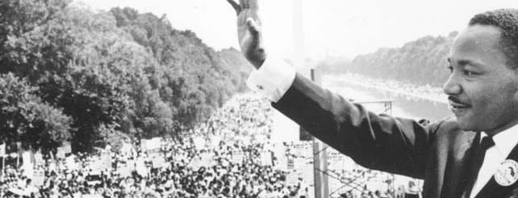

Martin Luther King Jr. day is celebrated in different ways across the country. At Bainbridge High School, it is celebrated with an essay and poetry contest. Many students each year decide to take up the challenge to write about what Dr. King means to them, how he inspires and has impacted them. This year, Spartronics is proud to say that one of our marketers, junior Jennifer Allen was one of the winners of this contest.

Allen wrote about peace and equality, she wrote about struggle and hardship. She read her beautiful essay for the school at the assembly BHS had this past Friday, and the students loved it. Spartronics is very happy to congratulate her on this accomplishment and to continue to encourage her pursuit of the arts.

[A digital version of her essay can be found here.](/files/MLKShortEssay.pdf)
