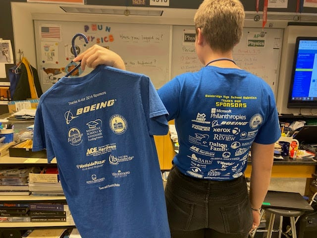
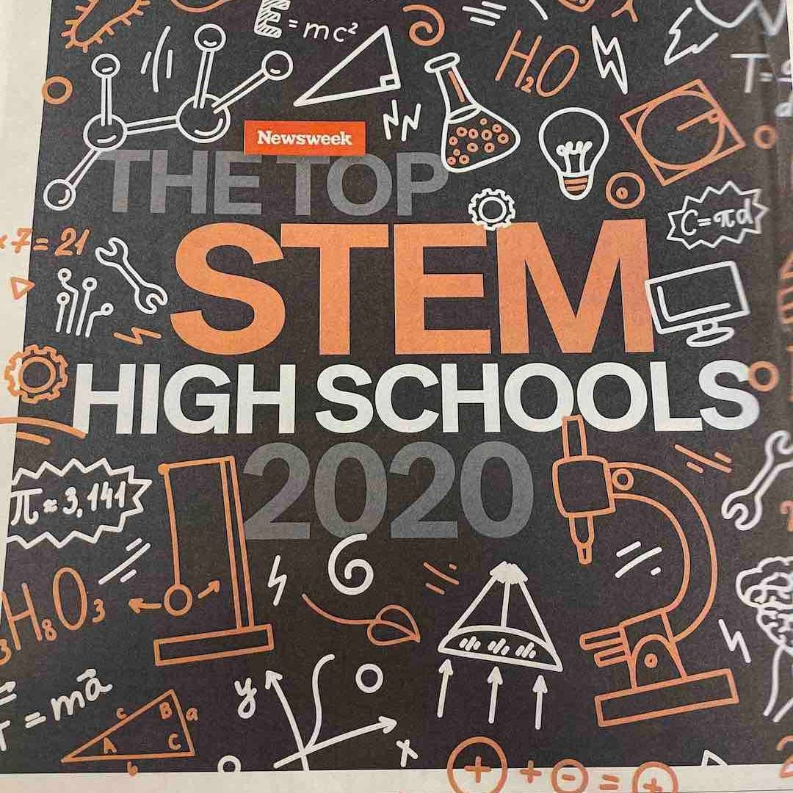
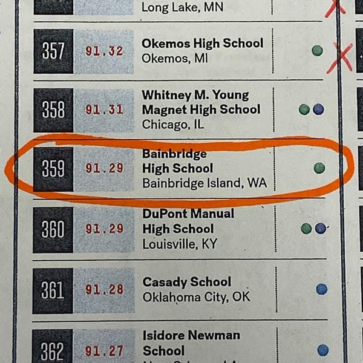
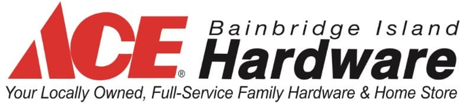
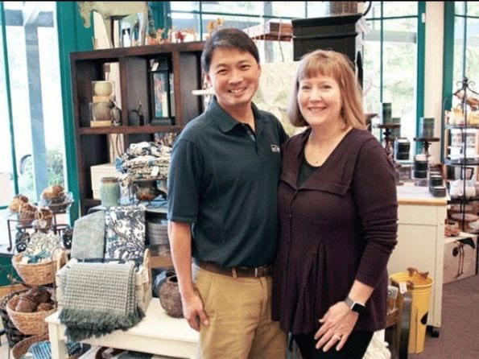

 _The Marketing subteam is finalizing 2020 Sponsors! Emma Lahtinen shows how our Sponsor support has grown, holding our first Team Shirt (2013-14) and wearing last year's shirt._ **Subteam Updates:**

Right now, **Programming** subteam is teaching its members Worcester Polytechnic Institute’s brand new command based framework. The command based framework is essentially tying individual actions to buttons on the controller. The newest version does not crash as much, so it is much more efficient. People are experimenting with cameras and point cloud [intellisense](https://spatronics4915.us9.list-manage.com/track/click?u=83401ef6f6634dd529783840a&id=8960bf8c9b&e=96dbbba0fa) cameras and are learning how to use Java and C++. Justice James, one of the team captains, is highly optimistic for this season and feels it will be a lot of “phun."

Similar to programming, **Mechanics** subteam is training its new members how to operate everything. They are mainly focussing on how to use the tools in the shop correctly - and safely. They are working to get prepared for build season. Another team Captain, Cruz Strom, is also optimistic for build season. There is a lot of planning and preparation happening in the off season, and Cruz says that will lead to a great build season.

The **Marketing** subteam team recently went on its first "Walkabout" of the season. The walk involves a group of students paired with Marketing Mentor Bill Davis (a.k.a. Uncle Bill) going to different businesses throughout Bainbridge Island and asking owners to become a Spartronics Sponsor. In the process, students explain what the team does, all the different Sponsorship levels, and what it takes to become a sponsor. Students report that the first walkabout went well. The new members of the marketing team are being trained how to use a variety of tech tools including WordPress (websites), MailChimp (email platform), and Photoshop (Graphics), we well as write our newsletter and keep our social media channels current. A new [Spartronics brochure](https://spatronics4915.us9.list-manage.com/track/click?u=83401ef6f6634dd529783840a&id=a002255e9d&e=96dbbba0fa) and Sponsor Benefits flyer was created and share with the Marketing subteam. 

In the **Electronics** subteam**,** members are rotating week-to-week, training between two different fields: pneumatics and electronics. Pneumatics uses air power to move different parts of the robot. It's typically used for up and down motions, as it works quickly, using air and cylinders. Spartronics’ robot from last year, CHAOS, used pneumatics for climbing. The other field, electronics, is used primary for the other movements of the robot, as well as its sensors and motors. Subteam leader Emerson Nicolas is enthusiastic about this group's prospects for this season because the Electronics subteam is no longer understaffed. There were only three members on electronics last season, and this season has the number of members in electronics triple the size to nine members.

_Bainbridge High is ranked by NEWSWEEK in the [TOP 500 STEM High Schools](https://spatronics4915.us9.list-manage.com/track/click?u=83401ef6f6634dd529783840a&id=69a7a14084&e=96dbbba0fa) in America! We are at 359 - our highest ranking ever. GO SPARTRONICS!_

**Sponsor Spotlight: ACE Hardware of Bainbridge Island**

[Bainbridge Island ACE Hardware](https://spatronics4915.us9.list-manage.com/track/click?u=83401ef6f6634dd529783840a&id=c30c572f7e&e=96dbbba0fa) owners, Steve and Becky Mikami, for nearly 30 years, have kept island homes happy and healthy. From plumbing fixtures to power tools, holiday decorations and small appliances, they have everything needed to keep a house well appointed and maintained.

ACE Hardware has been one of Spartronics’ top Sponsors since we were born. This marks their seventh straight year of support as a Legacy Gold Sponsor. Like many island households, Spartronics purchases a lot of replacement tools and supplies here during our build season. Steve and Becky have come to our Open Houses and have visited us during the build season.

Not only is ACE Hardware of Bainbridge Island large supporters of Spartronics, they are also huge Bainbridge Island community supporters, which may be the best thing about them. They have been honored by many organizations for all of their good deeds. Read **[here](https://spatronics4915.us9.list-manage.com/track/click?u=83401ef6f6634dd529783840a&id=9972fcaa4e&e=96dbbba0fa),** this great story from our media sponsor, the _Bainbridge Review_.

A remarkably humble couple who never seeks the spotlight, Steve and Becky deserve our praise and gratitude, because, without their continued support, we would not have the immense success we have as a team. Helps us send them a note of thanks by "liking" Bainbridge Island ACE Hardware [Facebook Page here.](https://spatronics4915.us9.list-manage.com/track/click?u=83401ef6f6634dd529783840a&id=04d718b9e6&e=96dbbba0fa)

