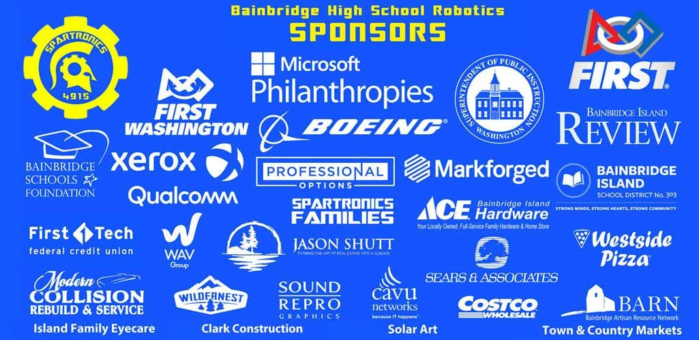

This year, we are all aware of the challenging times in our community. Our entire team has been extra appreciative of all the community support we have received over the last seven years and are looking to pay it back. We especially appreciate our sponsors. Last season, because of the outbreak of COVID-19 and our robotics season's suspension, we did not get to give to our sponsors all that we promised.

So, instead of asking our Sponsors to support us, we want to support them! We call it "Sponsor the Sponsors." We are looking for ideas to help them in creative and innovative ways. Our first step: We are reaching out to all of our 2020 Spartronics Sponsors to learn what we can do as a team to help them and their businesses. We will be asking all of our supporters to help us with our "Sponsor the Sponsor" efforts. Stay tuned for more information!

