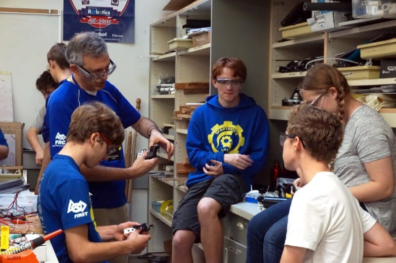
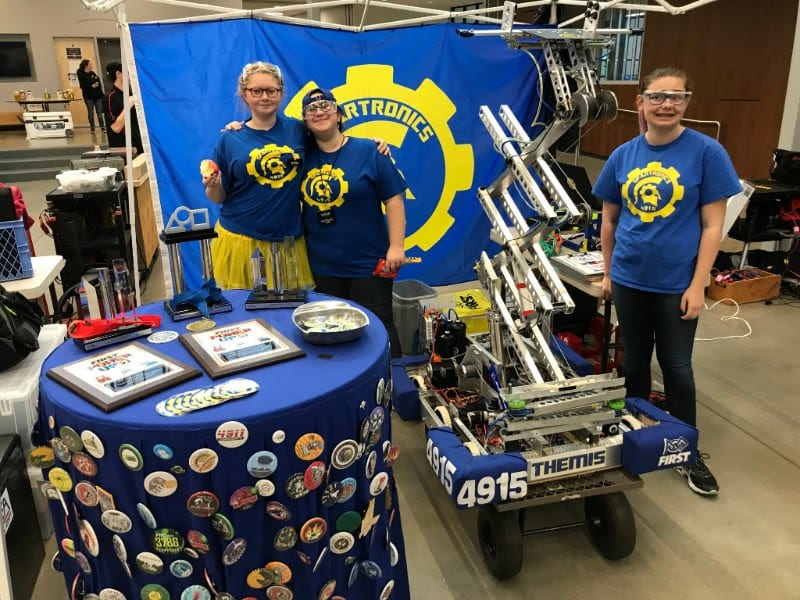

**Subteam Updates:**

We’re excited to welcome all students, new and old, to our team. Everybody involved has been putting in all of their effort to prepare for the upcoming competitions. With each subteam working hard on their respective tasks, Spartronics are busier than ever!

In programming, the majority of time spent so far has been dedicated to teaching newcomers the ins and outs of coding. They’re helping aspiring programmers organize code, as well as showing them the repository structure, which is where the code for the robot is kept.

On the other side of the team, our innovative group of mechanics is demonstrating the engineering-design process to new members. Learning the process of prototyping gives the students an idea of how they can transform a variety of parts into a functional robot.  

On the marketing subteam, students have mainly been focusing on finding businesses to sponsor Spartronics. Finally, electronics has been teaching new members about everything related to the electronics systems that we use in each of our robots. Newcomers have been quick to learn pneumatics, the use of pressurized air in the robot.

**Girls Generation and FIRST LEGO League**

Girls Generation, the annual competition that highlights the talented young women in FIRST Robotics, took place last weekend. Seven team members participated and many others went to show their support.

We came in eighteenth place out of the thirty-seven total teams that competed. Despite not winning the competition, everyone who went had a great time. “It went really well and we had a lot of phun!” said Violet Advani, a Spartronics veteran.

Thank you to everyone who showed up to support these aspiring programmers, mechanics, marketers, and electricians in their robotics adventures!

Spartronics will be hosting a FIRST LEGO League (FLL) competition on December 8th from 10 am - 4 pm. FLL features teams of kids ages 9-16 who build LEGO robots. They'll be participating in a game called Into Orbit. We'll also be hosting a FIRST LEGO League Jr. challenge called Mission Moon at the same time. Everyone is welcome to come and watch both events!
