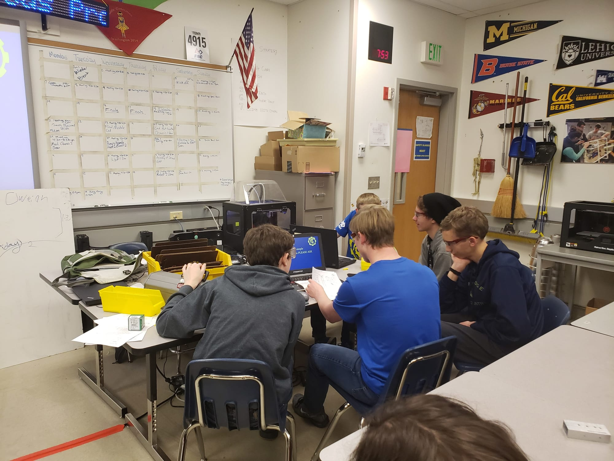
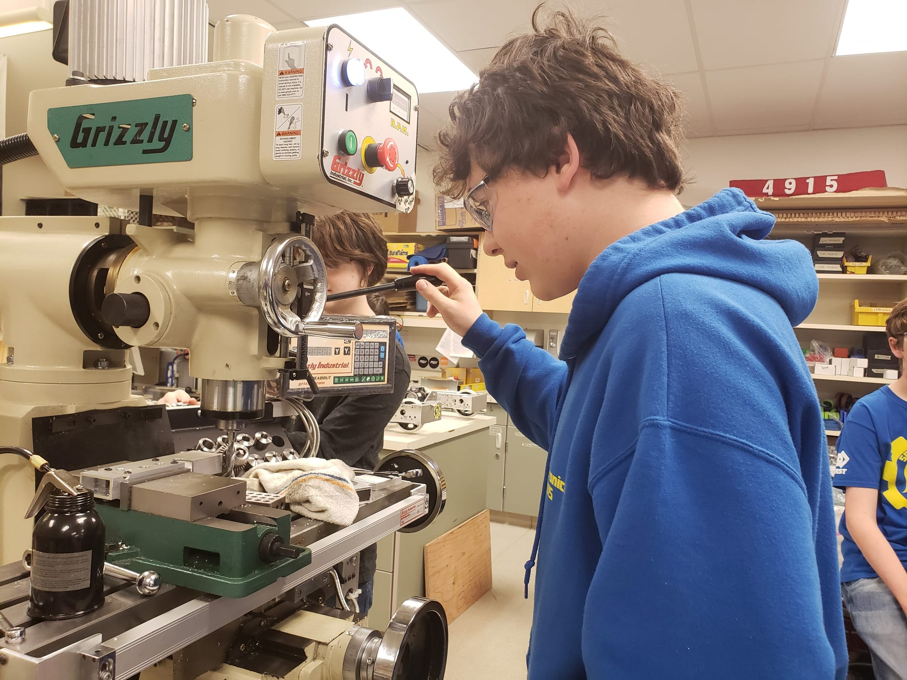
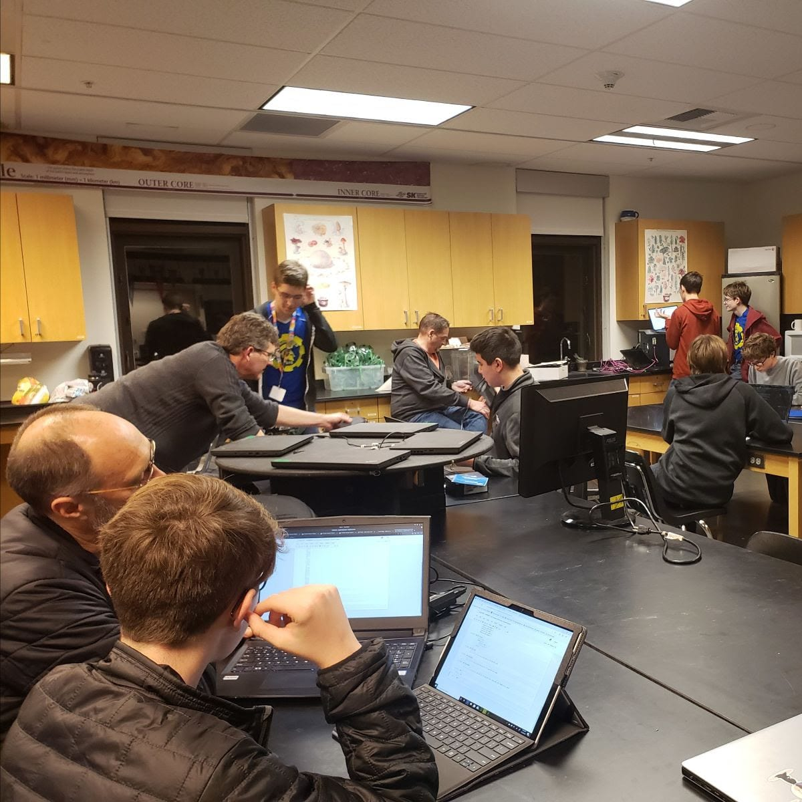
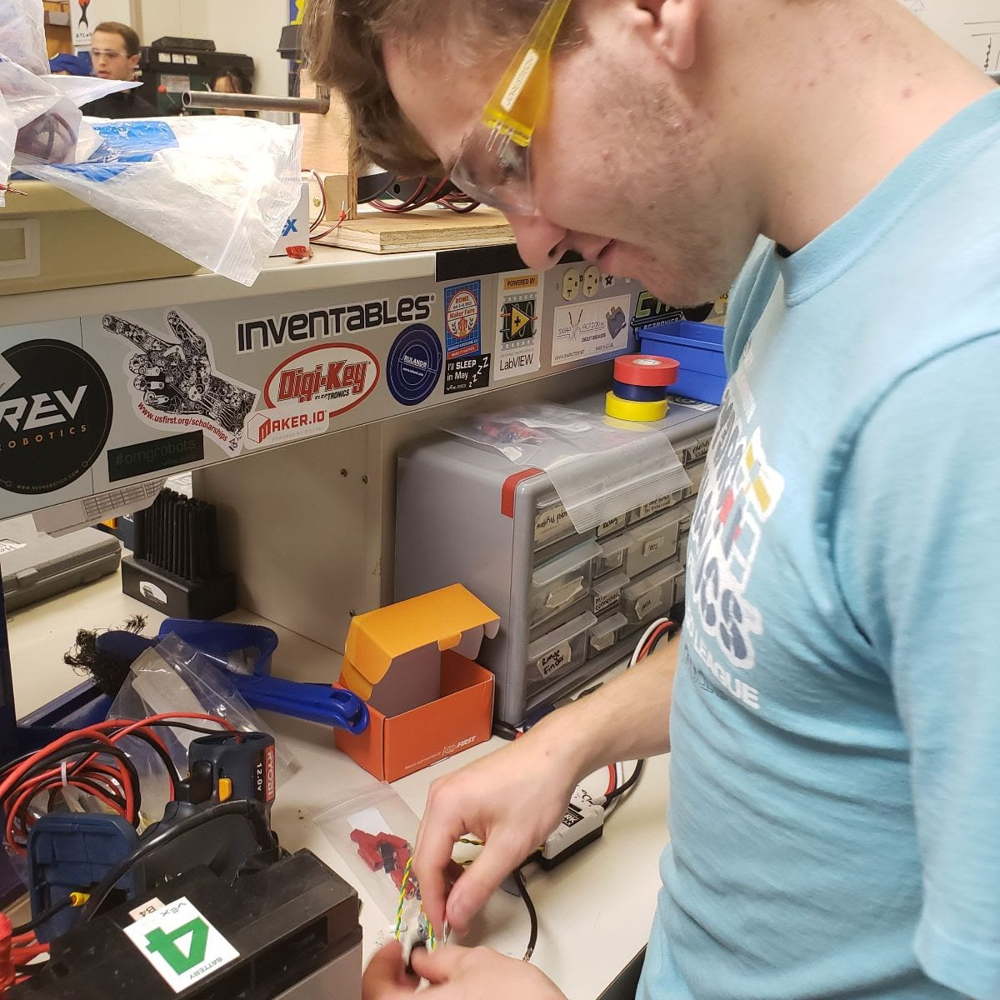

    **Subteam Updates:** In **Mechanics**, student skill sets are being finalized as well as student certifications and safety training for the machinery. Robot inventory is being updated to make certain the team has enough materials for build season. In Design, they are finishing up classes so they can build this year's robot. Team Co-Captain Cruz Strom is always looking forward to build season and says he us confident everyone will do a good job. Leadership team member Darwin Clark adds, “No, he’s not. He’s ready to move to Antarctica.” **Programming** is working on a variety of things. Their crew is using [Bling](https://spatronics4915.us9.list-manage.com/track/click?u=83401ef6f6634dd529783840a&id=5a0e787f56&e=96dbbba0fa), [Java](https://spatronics4915.us9.list-manage.com/track/click?u=83401ef6f6634dd529783840a&id=e3446b27b3&e=96dbbba0fa) and [Vision LIDAR](https://spatronics4915.us9.list-manage.com/track/click?u=83401ef6f6634dd529783840a&id=1a9d7c295d&e=96dbbba0fa). They are learning new Robot codebases, working on data analysis and testing cameras. Leadership team member Justice James is looking forward to build season, as well as the official release of the newest codebase. He also is excited about the 2020 kickoff. Currently, the students are building a full system for practice in **Electronics**. Specifically, Leadership team member Kate Treviño-Yoson is working on a button board, which is used bor customized controls. This will be helpful during build season and will speed the process up. Harper Nalley, Jacob Miles, and Dashiell Neff are working with LED lights for blinging the robot up. Peter Hall is looking forward to build season and thinks everyone will have a lot of “phun." **Marketing** is working to honor Woodie Flower in our attire: both our new Team Shirt and name badges. They are preparing for build season by finalizing sponsorships and finishing up training for new members.  **Sponsor Spotlight: Professional Options**

Doña Keating is President and CEO. Professional Options LLC, a Spartronics sponsor for two years, now. Doña is also a professional Mentor of our team and our Community Ambassador. She believes strongly in the power of STEM (Science, Technology, Engineering, and Math) and its ability to impact the future.

Professional Options is a consulting firm for leadership and management. They advise NGOs (non-governmental agencies), Fortune 100, governments, and non-profits on best practices. They do this so these organization’s leaders can improve their strategies, teams, and missions. Professional Options also provides facilitation of executive board Dona Keating treats and meetings, as well as public advocacy of digital privacy, telecommunicators, education, technology innovation, economic development, and entrepreneurship. Professional Options is sponsoring Spartronics because Doña is a large supporter of STEM initiatives, and she feels that computer programming is a necessary life component in this day and age. "Spartronics does a fantastic job of educating people about this second language as well as it’s implementation through robotics," she says. "It also helps build communication skills, promotes collaborative teamwork and critical thinking. Spartronics helps prepare the students for the real world. The intelligence, emotional and mental, of the team, coach, mentors and students alike, is electrifying and inspirational." Doña “can’t imagine living or working on Bainbridge Island and not supporting Spartronics.” The best way to show our appreciation and support for Professional options is to check out their Facebook page. Doña would prefer, however, that the members focus on the team, support and engage in Spartronics. Follow them on Instagram, Facebook, and Twitter. Professional Option’s URL is [http://www.professionaloptions.com](https://spatronics4915.us9.list-manage.com/track/click?u=83401ef6f6634dd529783840a&id=a340d3a934&e=96dbbba0fa)  Thank you Professional Options and Doña Keating for all of your support!
