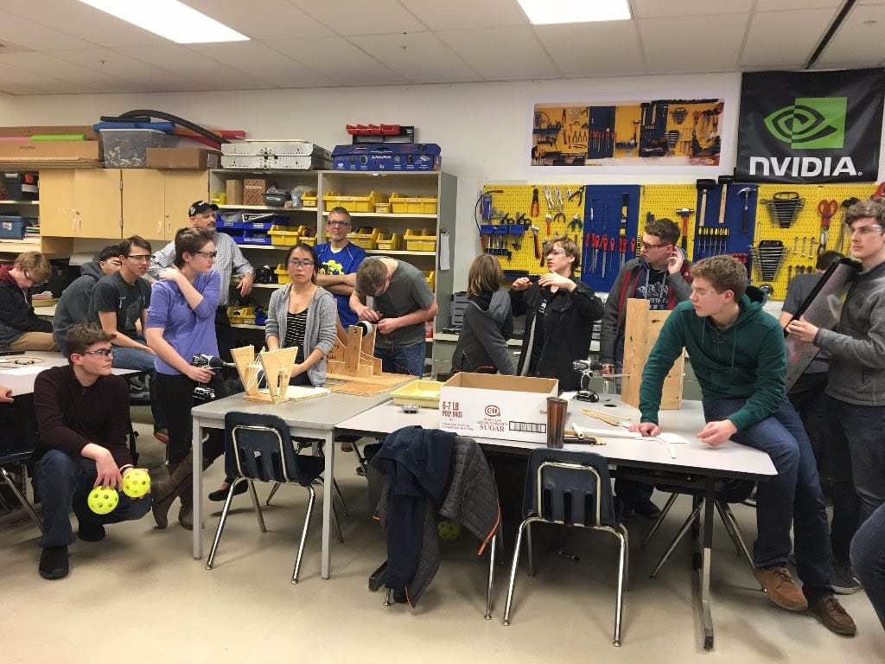

This week was the second week in the 2017 build season and all the subteams are working together and making great progress in building the robot. The mechanics and programmers have been successful in collaborating to complete a functioning and moving chassis. The electronic subteam and the mechanics have created a prototype launcher for the high goal that is now working completely electronically! The mechanics have also been working to layout everything in CAD and will be done with virtually prototyping EVERYTHING by Sunday, Jan. 22. After they have completed this step, they will be able to start the actual build process, following the already completed specs. Lia Johansen, one of the head programmers, shared that the programmers have had an especially “successful and awesome” start to the season. In the history of Spartronics, this is earliest point ever in our build season that the chassis has been moving and performing reliably. The programming team has already moved on to working on coding for the robot’s autonomous mode and will continue working on this into next week.
