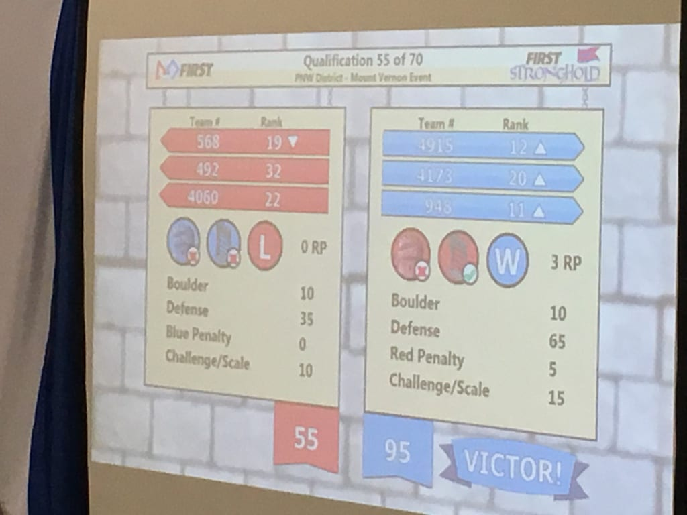
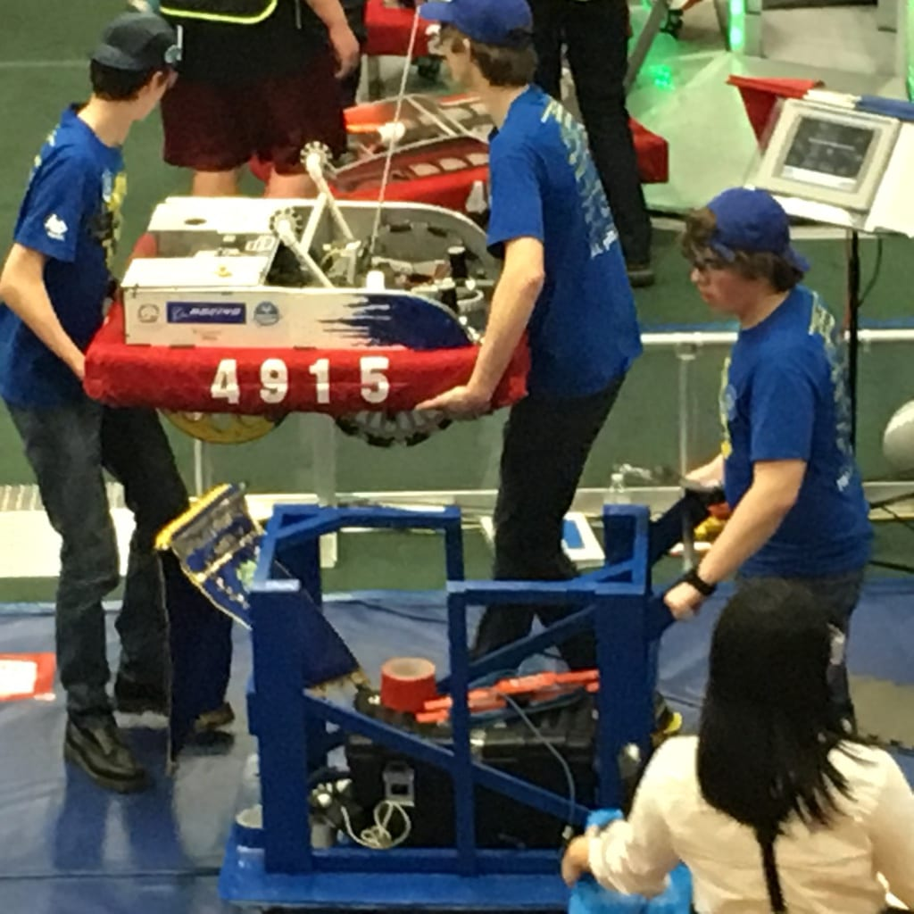
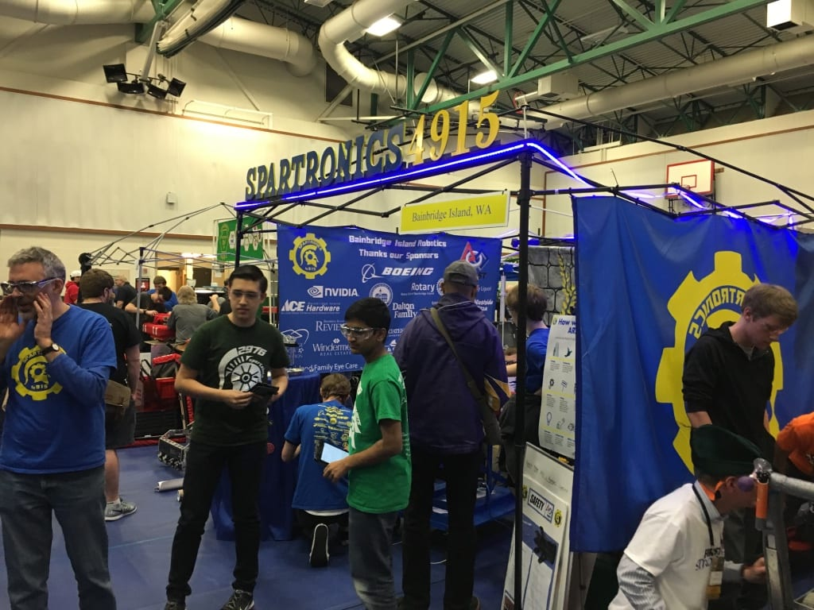
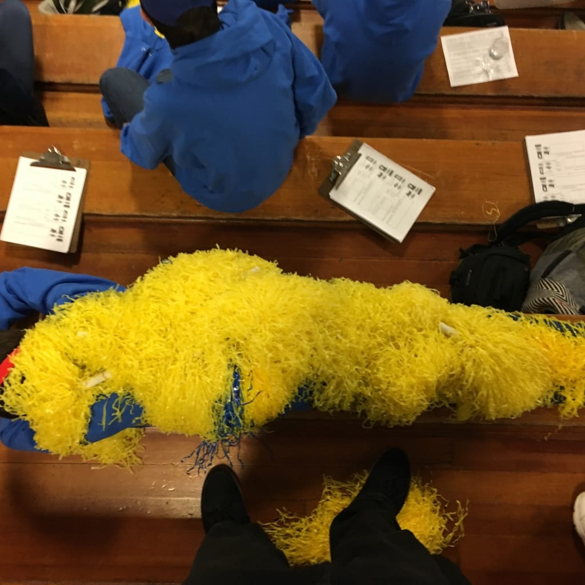

After the first day in Spartronics second District Event competition, the team was ranked 13th overall, far higher than how we finished in Glacier Peak. ARES is battling through the high-impact game -- Stronghold - and despite a broken chain that connected one of its front wheels went on to finish supporting its final Alliance with a winning score of 95-55.

It was still another topsy-turvy day as many robots found themselves out of commission for all or part of a match. In fact, just before our second to final match, Spartronics drive team, mechanics and even mentors tried frantically to fix an erant steering problem.

Throughout it all, Spartronics teammates, mentors, parents and supporters rallied to cheer on their team.  Just two more morning matches on Sunday with a lunch break at 11 am and finals matches starting at 11:30 am remain at Mount Vernon High School.

Other teams have rallied to our support, helping us with parts and applause. Whatever happens on Sunday, Mt. Vernon will go down in the record books as a frantic, but fun event -- and another great learning experience in fixing challenges when they arise. 

Alex, Robby and Kolin get ARES on the field just in the nick of time!

Lot of activity at our Pit today - other teams and 3 sets of Judges visited.

Under all those yellow pom-poms is our resident Spartronics artist, Rose. So this is a yellow Rose.
