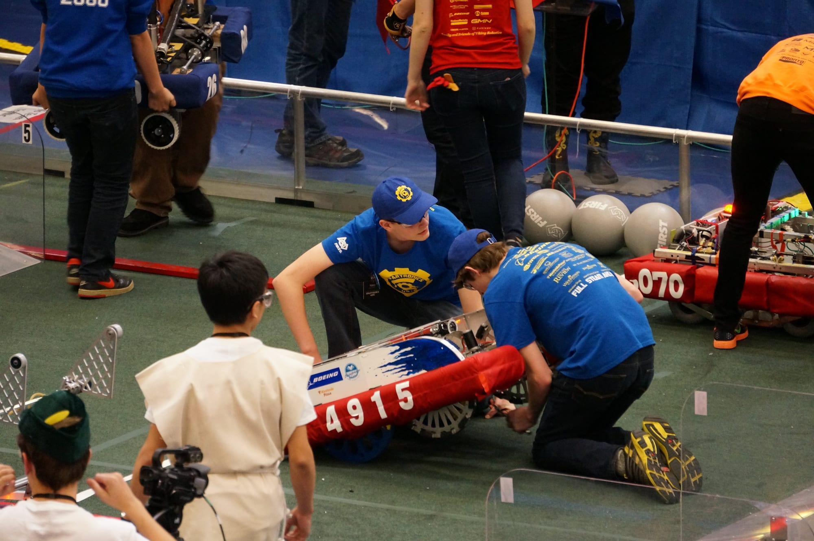

**By Kolin Hawkins | Drive Team Coach**

The Glacier Peak District Event, as our Mentor Dana Batali so aptly described, was an epic saga of medieval proportions for Spartronics 4915. We wanted to provide a full account to anyone who was there experiencing these unusual circumstances with us, or those of you watching at home or video recordings. Our goal here is to do two things: First, to provide transparency about what happened and, to the best of our collective knowledge, why it happened, and Second, what we have done to fix our robot ARES.

The good news is we are confident that we have addressed the critical issues that impacted our ability to perform consistently as well as the issues that ultimately caused our Spartronics robot to miss a match. This was a first in our team’s three-year history, which is remarkable considering we went all the way to Worlds these first two years.

Here is a full recap of the events at Glacier Peak, and at the end, details on what we did during our six hours of un-bag time this week.

**What went wrong at Glacier Peak:**

1\. **Our wiring was not robust enough for the impacts** due to our rigid chassis, resulting in loss of radio connection. We have addressed by better wiring techniques and suspension elements.

2\. **The breaker switch mounting did not take into account extreme flexing of the robot frame** and shielding, and resulted in unexpected power-down. During the competition, we drilled holes in the shielding, and later we move the switch to a safer position.

3\. **Networking configuration of our components resulted in some issues with getting updated software on the robot,** and may have contributed to problems on the field. We addressed by taking the advice of an FTA at the event, configuring all of our on-board devices with static IP addresses to eliminate potential issues with DHCP and mDNS.

4\. **Software errors** resulted in some autonomous failures, hampered driver operation, and reduced the capabilities of our launcher. These problems didn't surface earlier due to limited testing of our software before the event, which was a result of being more aggressive than usual with our mechanical design, leaving too little time for extensive testing. During the course of the Glacier Peak event, many changes were made to the code, and we made every effort to test on the practice field before competing, although there were still a few errors that made their way through to competition. We spent two hours of our un-bag time working on software issues and cleaning up our code.

5\. **We encountered what other teams encounter during competition:** All the other little things that happen to a robot in battle: adjusting limit switches, tightening bolts, etc., which on top of the issue above, added to our challenges. We recognized that we need to make our systems more robust, and do more testing, in order to spend pit time doing these normal maintenance tasks, and not count on the time for design changes.

**What we have done:**  

*   We have relocated our electronics from being in a vertical position inside the robot to a horizontal layout, which improves significantly better access for maintenance and repair.

*   We located our breaker to move it away from the polycarbonate top, which was accidentally turning off the robot when a large shock caused the polycarbonate to flex and press the breaker button.

*   We added wire ferrules to critical connections between the radio and the VRM so that power loss to the radio will be avoided. Previously, critical wires were getting disconnected.

*   We added a suspension system to the robot to cushion its landing after it crosses defenses.

*   Our turn button on the joystick was fixed, which allows us to more accurately turn the robot.

*   We added code that allows us to spin the flywheels at a better speed to more effectively shoot low goals. Previously, the intake speed and the shoot speed where the same and the low goal often bounced out.

**What has changed:**  

*   We will not be shooting high goals at Mount Vernon, as we made adjustments to the pivot point on our intake, which will give us more stability and allow us to better control scoring low goals.

*   We added a Portcullis lifter/Cheval de Frise manipulator, which we have not tested in a match, but are hopeful will help us assist with breeching these defenses.

We are excited about Mount Vernon this weekend and are ready to answer any questions other teams may have.
