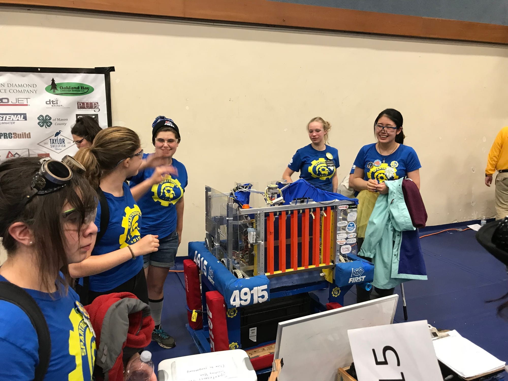
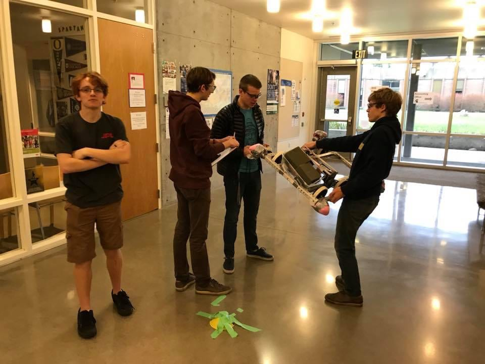

## 

## Subteams and FLL Tournament:

Robotics season 2017-2018 has started off with a bang! Every subteam has their own way of warming up for build season. Mechanics have been taking apart our 2013 robot, ATLaS (Advanced Tele-operated Launching System), for a drive team practice chassis. Electronics has fixed the countdown clock, which displays the final Kickoff time on January 6th. Kickoff is when we find out the details of this year's game and marks the start of build season. In order to prepare for Kickoff, the marketing subteam has been busy fundraising and programming has been training new members with a series of preseason projects. As Spartronics is gearing up for build season, other teams are preparing for competition. We’ll be hosting a First Lego League (FLL) event on December 9th from 10am - 4pm. FLL features teams of kids ages 9-16 building Lego robots. This year, they'll be competing in a game called Hydro Dynamics. We welcome everyone to come and spectate.

## Girls Generation:

The girls on our team aren’t waiting for the start of the season in order to compete, they’ve already been on the field. Girls Generation, an event created and hosted by Bear Metal Robotics Team 2046 at their old Tahoma High School digs, aims to provide female members of FIRST a chance to compete with other girls from other teams around the area. This was our fourth time participating in the competition, and we competed well, ending up placed 15th overall out of 36 teams.

More impressive than our ranking was our attendance. Over half the team showed up for the event. This meant Spartronics had one of the largest turnouts of supporters. We had six girls on our drive team, with only two returning members. This gave four new members of our team a great chance to distinguish themselves.

Rose Bandrowski is one of the team’s captains and a member of Girls Gen’s Driving team. She summed up how she thought another member of the drive team did, “I was really proud of Sam, she did a really good job.” Sam and everybody else on the drive team were able to pick up valuable skills driving the robot. Rose went on to say, “The team did a great job showing support!” Overall, Girls Generation gave the girls of the team an opportunity to pick up mechanical skills before the start of the season and the rest of the team had a lot of "Phun." We're so thankful to our Mentors, especially Binnur, Riyadth, and Kirsten, for helping us and making our participation in the competition possible.

## Drive Team:

This year, the team is trying a more intense schedule of drive team practice. Tryouts for driver are currently being held with eleven people in the running. Selection will be based on merit, giving us the most qualified driver for the upcoming season. We’re very excited for how this new process will help us out during competition season and thankful for our mentor Chris Risinger for facilitating it.  
This newsletter will become a weekly feature during the build season, starting January 6th. It will cover what each subteam is doing, how we prepare for competitions, the date and times of those competitions, and all other relevant news.
