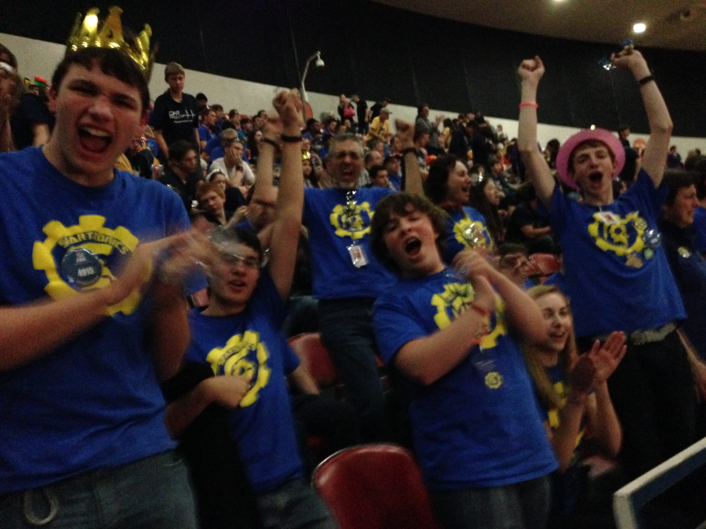

It was 2014, our Rookie year and our first trip to the FIRST FRC Pacific Northwest District Championship. We had earned enough points to compete with the best of the best from Oregon and Washington, traveling to Portland to complete in a building next where the NBA Trailblazers Play.

Spartronics competed well in the Championship matches and thought we would certainly get picked by an Alliance for the Quarter Finals. We listened as Teams ranked well below us were selected and when the final team name was called, we were in shock that we did not get picked. The mood was pretty gloomy, taking the wind out of our most optimistic supporters. We thought our hopes for a Rookie year Worlds appearance was dashed.

Then, at the end of the matches, they posted on the big screen a list of PNW teams that qualified, based on points for the FRC FIRST Robotics World Championships. On that list was Team 4915, Spartronics. Despite not making the finals, we earned enough points to go to the Big Game. This is a photo that says it all, taken seconds after the list was revealed:

We will not know if Spartronics are headed to the [FIRST FRC Pacific Northwest District Championship](http://oregonfirst.org/events/district-events/2016-schedule/2016-district-championship/) for the third year in a row until the end of the final competition April 3. But right now the Spartronics [are ranked 27th](http://www.thebluealliance.com/events/pnw#rankings) and the top 64 team will be eligible for the trip back to Portland April 6-9 with teams from Washington, Oregon and Alaska eligible. The chances of going back are very strong, but we won't know for certain if our robot ARES gets to play Stronghold in Portland until we get the official word. So stay tuned and GO SPARTRONICS!
